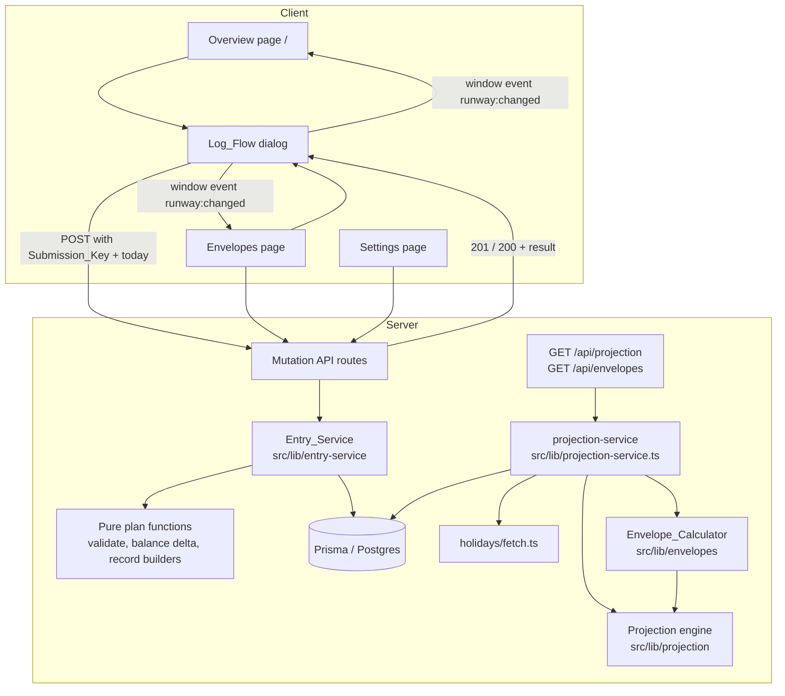
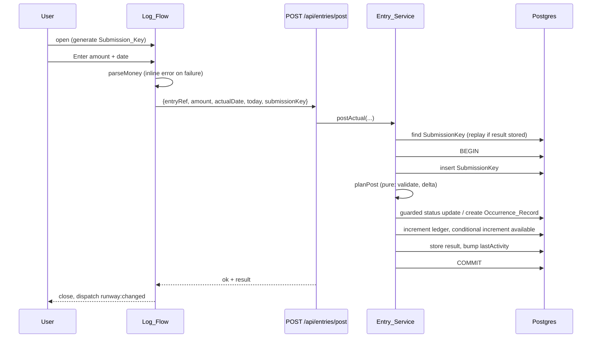

# Design Document: Plan vs Actual and Envelopes

## Overview

This design covers Spec 2 of Runway. Spec 1 delivered the pure projection engine and the Cycle_View (the Overview page at `/`). This spec lets the user record what really happened (post an actual, skip, add a one-off), see variance against estimates, and track flexible spending in envelopes. The runway recomputes after every change.

Because the demo has no bank feed, the app keeps the Primary_Account balances current itself. Posting an actual, saving an already-happened one-off, and logging a purchase each move the ledger and available balances in the same database transaction as the record change. The engine already treats a POSTED entry as "included in the balances", so posting a bill at its estimate on its due date does not move the runway (Requirement 3.7).

Envelopes reach the projection as **Envelope_Commitments**: for each envelope with money left, one synthetic, non-persisted debit equal to `Left`, dated the Commitment_Date. Logging a purchase moves money from "committed" to "spent" with no runway change until the envelope is overspent. Past that point the runway drops by exactly the overage.

**Key design decisions**

| Decision | Rationale |
| --- | --- |
| Pure "plan" functions decide every mutation (validation, resulting fields, balance deltas). Thin Prisma executors apply the plan inside one transaction. | Keeps the rules property-testable with Vitest and fast-check. The DB layer only needs a few integration tests. |
| New engine inputs are optional (`occurrenceRecords`, `envelopeCommitments`). With both absent the output equals Spec 1 output. | Satisfies Requirements 9.9 and 16.1 without touching Spec 1 assertions. |
| Occurrence_Records live in their own table, not in `OneOffEntry`. | The Spec 1 route and tests keep their meaning for `OneOffEntry`. A unique key on `(workspaceId, scheduleId, occurrenceDate)` prevents double posting. |
| Envelope_Commitments never enter `entries`, `upcomingEntries`, pay cycles, or warnings. They only feed `projectBalances`. | Commitments are not timeline items and must not create overdue or cycle-summary noise. |
| Double-submit protection uses a `SubmissionKey` row inserted first inside the transaction. | The unique index serialises concurrent duplicates in Postgres. The loser sees a unique violation and replays the stored result. |
| Balance changes use atomic `increment` updates, and the null-available case is a separate conditional `updateMany`. | No lost updates under concurrency, and a null available balance stays null (Requirements 3.5, 3.12, 8.10). |
| The Envelope_Calculator receives scheduled-income dates as an argument. | It stays pure. A separate pure helper builds those dates from schedules and records, so one-off income and skipped occurrences never become envelope boundaries. |

### Research summary

- **Existing code (read before designing).** `projectCashFlow` generates schedule entries only from `currentDate` forward and treats POSTED entries without a hold as already in the balances. `computePayCycles` counts every non-SKIPPED income, so a POSTED scheduled income keeps its boundary (Requirement 2.10) and a SKIPPED one drops out (Requirement 4.3) with no change. `findOverdueEntries` already requires `status === 'PLANNED'`, so POSTED and SKIPPED are never overdue (Requirements 2.9, 5.9, 5.13, 16.6) with no change.
- **Gap found.** Generated entries start at `currentDate`, so past scheduled income is invisible to the engine. The Envelope_Calculator needs it for EACH_PAY_CYCLE periods, so the service builds a lookback window of scheduled-income dates with the existing pure `generateEntries` and `shiftDate`.
- **Commitment_Date.** A period always contains the Current_Date, so `Current_Period.start <= Current_Date` and the "later of" rule always yields the Current_Date. The formula stays in code to match the requirement text.
- **Demo seed arithmetic.** The Spec 1 demo runway is about $130 ($1,500 available, minus overdue phone, rent, electric and gym, plus the $40 held deposit). Envelope budgets in the seed are sized so total `Left` stays below that and the runway stays non-negative and below the $200 threshold (Requirement 15.7).
- **Prisma behavior (from the Prisma docs on [transactions](https://www.prisma.io/docs/orm/prisma-client/queries/transactions) and the [P2002 unique-constraint error](https://www.prisma.io/docs/orm/reference/error-reference#p2002)).** Interactive transactions roll back when the callback throws. Atomic number operations such as `increment` run as `col = col + n` in SQL. A second insert of the same unique key waits for the first transaction, then either fails with P2002 (first committed) or proceeds (first rolled back). That gives Requirements 11.5 and 11.9 for free. I did not re-fetch these pages this session, so treat the exact error shapes as something the integration tests must confirm.
- **fast-check.** `fast-check` 4.10.2 and Vitest 5.0.5 are already dev dependencies. No new dependency is needed.

## Architecture



**Flow for a read.** `GET /api/projection?today=` and `GET /api/envelopes?today=` both call `buildWorkspaceView` in `src/lib/projection-service.ts`. It resolves the workspace from the cookie, loads accounts (through the `AccountDataSource` wrapper already used by the route), schedules, one-offs, occurrence records, envelopes and line items, fetches holidays, then calls the pure modules in this order:

1. `collectScheduledIncomeDates` over a lookback window plus the generation window, using schedules and records only.
2. `periodContaining` for each envelope, then `computeEnvelopeTotals`.
3. `buildEnvelopeCommitments` from those totals.
4. `projectCashFlow` with `occurrenceRecords` and `envelopeCommitments`.
5. `computeCumulativeVariance` over POSTED entries and `payCycles[0]`.

**Flow for a write.** Each mutation route validates the body shape, calls one Entry_Service function, and returns `{ ok: true, result }` or `{ ok: false, error }`. On success the client dispatches `runway:changed`. The Overview and Envelopes pages listen for it (the same pattern as the existing `DEMO_RESET_EVENT`) and refetch.



### Module layout

New and changed files, following `structure.md`. Pure modules never import `@/lib/db`, `@/sources`, or any network code. A smoke test enforces this (Requirement 16.3).

```
prisma/
  schema.prisma                         # + Envelope, LineItem, OccurrenceRecord, SubmissionKey; OneOffEntry.actualDate
  seed.ts                               # unchanged entry point (uses seedWorkspace)
src/
  lib/
    money.ts                            # Money_Parser: parseMoney, formatCentsPlain          (pure)
    projection/
      types.ts                          # + Entry.actualDate?, EnvelopeCommitment, new optional ProjectionInput fields
      engine.ts                         # records replace generated occurrences; commitments feed projectBalances
      variance.ts                       # entryVariance, computeCumulativeVariance            (pure)
      dates.ts                          # + isValidDate                                       (pure)
    envelopes/                          # Envelope_Calculator                                 (pure)
      types.ts
      period.ts                         # periodContaining, precedingPeriod
      income-dates.ts                   # collectScheduledIncomeDates
      totals.ts                         # computeEnvelopeTotals
      commitments.ts                    # buildEnvelopeCommitments
      view-model.ts                     # buildEnvelopeCardView
    entry-service/
      errors.ts                         # ServiceError, error codes                           (pure)
      balance-delta.ts                  # postingBalanceDelta, lineItemDelta                  (pure)
      plan-post.ts                      # planPost, planSkip                                  (pure)
      plan-one-off.ts                   # planOneOff                                          (pure)
      validate.ts                       # validateEnvelopeInput, validateLineItemInput, validateSettings (pure)
      occurrence.ts                     # parseEntryRef, buildOccurrenceRecord                (pure)
      idempotency.ts                    # runIdempotent (Prisma)
      service.ts                        # postActual, skipEntry, addOneOff, envelope + line item + settings mutations (Prisma)
    projection-service.ts               # buildWorkspaceView (I/O orchestration)
    seed-workspace.ts                   # + envelopes, line items; clears new tables on reseed
  sources/
    fake-source.ts                      # generateDemoData adds envelopes + line items
  app/
    api/entries/{post,skip,one-off}/route.ts
    api/envelopes/route.ts              # GET list, POST create
    api/envelopes/[id]/route.ts         # PATCH
    api/line-items/route.ts             # POST create
    api/line-items/[id]/route.ts        # PATCH, DELETE
    api/settings/route.ts               # GET, PUT
    envelopes/page.tsx, settings/page.tsx
  components/
    log-flow/{log-flow.tsx, post-actual-form.tsx, purchase-form.tsx, one-off-form.tsx, log-flow-state.ts, use-submit.ts, events.ts}
    envelope-card.tsx, variance-card.tsx
__tests__/ ...                          # see Testing Strategy
```

The `AccountDataSource` interface is unchanged. Balances written by the Entry_Service live in the workspace's `Account` rows, which the projection route already reads through its `WorkspaceDbSource`. A future `PlaidSource` replaces this write path without touching the engine.

## Components and Interfaces

### Money_Parser (`src/lib/money.ts`)

```ts
export const MAX_CENTS = 999_999_999;

export type MoneyParseResult =
  | { ok: true; cents: number }
  | { ok: false; error: string };

export interface ParseMoneyOptions {
  /** Settings threshold allows 0. All other amounts require at least 1 cent. */
  allowZero?: boolean;
}

export function parseMoney(text: string, options?: ParseMoneyOptions): MoneyParseResult;

/** 1205 -> "12.05". Integer math only. Inverse of parseMoney for 1..MAX_CENTS. */
export function formatCentsPlain(cents: number): string;
```

Algorithm, in precedence order, with no floats:

1. `trim()`. Empty gives "Enter an amount".
2. `^\d+\.\d{3,}$` gives "At most two decimal places are allowed" (never rounds).
3. Not `^\d+(\.\d{1,2})?$` gives "That is not a valid amount" (covers `abc`, `1e3`, `-5`, `1,200`, `$5`, `5.`, `.5`).
4. Strip leading zeros of the whole part. If it has more than 9 digits, return the range error (avoids precision loss before arithmetic). Otherwise `cents = Number(whole) * 100 + Number(frac.padEnd(2, '0'))`.
5. `cents < (allowZero ? 0 : 1)` or `cents > MAX_CENTS` gives "Amount must be between $0.01 and $9,999,999.99" (the message states the range in cents and dollars, and uses `$0.00` as the lower bound when `allowZero`).

### Entry-service errors (`errors.ts`)

```ts
export type ServiceErrorCode = 'VALIDATION' | 'NOT_FOUND' | 'CONFLICT';
export class ServiceError extends Error {
  constructor(public code: ServiceErrorCode, message: string, public field?: string) { super(message); }
}
export type Result<T> = { ok: true; value: T } | { ok: false; error: ServiceError };
```

Routes map `VALIDATION` to 400, `NOT_FOUND` to 404, `CONFLICT` to 409, anything else to 500 with a generic message. The Log_Flow shows `error.message` in an element with `role="alert"` next to the field named by `error.field`.

### Balance deltas (`balance-delta.ts`, pure)

```ts
export interface BalanceDelta {
  ledgerCents: number;     // always applied
  availableCents: number;  // applied only when the account's available balance is not null
}

export interface PostingInput {
  direction: 'INCOME' | 'DEBIT';
  /** PLANNED for scheduled occurrences and planned one-offs; PENDING for pending debits. */
  status: 'PLANNED' | 'PENDING';
  estimateMagnitudeCents: number;  // E, >= 0
  actualMagnitudeCents: number;    // A, > 0
  actualDate: string;
  holdReleaseDate?: string;
}

export function postingBalanceDelta(input: PostingInput): BalanceDelta;
export function postedOneOffBalanceDelta(input: Omit<PostingInput, 'status' | 'estimateMagnitudeCents'>): BalanceDelta;
export function lineItemDelta(change:
  | { kind: 'create'; amountCents: number }
  | { kind: 'edit'; oldCents: number; newCents: number }
  | { kind: 'delete'; amountCents: number }): BalanceDelta;
```

Rules (Requirements 3.1 to 3.4, 3.9 to 3.11, 8.10, 10.2, 10.3):

| Case | `ledgerCents` | `availableCents` |
| --- | --- | --- |
| Debit, PLANNED, actual A | `-A` | `-A` |
| Debit, PENDING, estimate E, actual A | `-A` | `E - A` |
| Income, no hold or `holdReleaseDate <= actualDate` | `+A` | `+A` |
| Income, `holdReleaseDate > actualDate` | `+A` | `0` |
| Income, PENDING | same as the income rows above | |
| Posted one-off | same as the PLANNED rows (no pending state) | |
| Line item create X | `-X` | `-X` |
| Line item edit A to B | `A - B` | `A - B` |
| Line item delete A | `+A` | `+A` |

Pending income is not covered by the requirements. The engine ignores PENDING income in `projectBalances`, so the safest consistent choice is to treat it like PLANNED income. I'll flag this when presenting the design.

When the account's available balance is null, the executor skips the available update, so it stays null. This rule lives in the executor, not in the delta, so the delta stays a plain pair of integers.

### Plan functions (pure)

```ts
// plan-post.ts
export interface PostableEntry {
  entryType: 'INCOME' | 'DEBIT';
  status: 'PLANNED' | 'PENDING' | 'POSTED' | 'SKIPPED';
  estimatedAmountCents: number;      // signed or magnitude; only the magnitude is used
  holdReleaseDate?: string;
}
export interface PostPlan {
  status: 'POSTED';
  actualAmountCents: number;         // signed by direction
  estimatedAmountCents: number;      // unchanged, signed by direction
  actualDate: string;
  balanceDelta: BalanceDelta;
}
export function planPost(
  entry: PostableEntry,
  input: { amountCents: number; actualDate: string; today: string },
): Result<PostPlan>;

export interface SkipPlan { status: 'SKIPPED'; balanceDelta: { ledgerCents: 0; availableCents: 0 } }
export function planSkip(entry: Pick<PostableEntry, 'status'>): Result<SkipPlan>;
```

`planPost` errors: invalid `actualDate` ("Enter a valid date"), `actualDate > today` ("An actual cannot be dated in the future"), status POSTED or SKIPPED ("This entry cannot be posted from its current status"). `planSkip` errors on POSTED or SKIPPED ("This entry cannot be skipped from its current status").

```ts
// plan-one-off.ts
export interface OneOffInput {
  direction: string;           // validated here, so any string may arrive
  amountCents: number;
  date: string;
  description?: string;
  alreadyHappened: boolean;
  today: string;
}
export interface OneOffPlan {
  entryType: 'INCOME' | 'DEBIT';
  status: 'PLANNED' | 'POSTED';
  postDate: string;
  estimatedAmountCents: number;           // signed
  actualAmountCents: number | null;       // equals estimate for POSTED
  actualDate: string | null;              // equals date for POSTED
  balanceDelta: BalanceDelta;             // zero for PLANNED
}
export function planOneOff(input: OneOffInput): Result<OneOffPlan>;
```

`planOneOff` errors, checked in this order: invalid direction ("Direction must be debit or income"), invalid date ("Enter a valid date"), `alreadyHappened && date > today` ("An actual cannot be dated in the future"), `!alreadyHappened && date < today` (exactly `Planned entries need a date today or later`).

```ts
// occurrence.ts
export type EntryRef =
  | { kind: 'ONE_OFF'; id: string }
  | { kind: 'OCCURRENCE'; scheduleId: string; occurrenceDate: string };

/** Generated entry ids are "<scheduleId>:<YYYY-MM-DD>"; one-off ids are cuids and contain no colon. */
export function parseEntryRef(id: string): EntryRef;

export function buildOccurrenceRecord(
  schedule: Pick<Schedule, 'id' | 'accountId' | 'name' | 'entryType' | 'estimatedAmountCents'>,
  occurrenceDate: string,
  outcome:
    | { status: 'POSTED'; actualAmountCents: number; actualDate: string }
    | { status: 'SKIPPED' },
): OccurrenceRecordData;
```

The executor checks that `occurrenceDate` is a real occurrence by calling the existing pure `generateEntries(schedule, occurrenceDate, occurrenceDate, [])` and requiring exactly one result with that `postDate`. An unknown occurrence returns `NOT_FOUND`.

### Validation (`validate.ts`, pure)

```ts
export function validateEnvelopeInput(
  input: { name: string; budgetText: string; resetPeriod: string },
  otherNames: readonly string[],          // names of the workspace's other envelopes
): Result<{ name: string; nameKey: string; budgetCents: number; resetPeriod: ResetPeriod }>;

export function validateLineItemInput(
  input: { amountText: string; purchaseDate: string; description?: string },
  today: string,
): Result<{ amountCents: number; purchaseDate: string; description: string | null }>;

export function validateSettings(
  input: { thresholdText: string; horizonText: string },
): Result<{ lowBalanceThresholdCents: number | null; projectionHorizonDays: number }>;
```

- Envelope name: trimmed, 1 to 60 characters, unique among `otherNames` ignoring case (`nameKey = trimmed.toLowerCase()`). Reset period must be one of `EACH_PAY_CYCLE | WEEKLY | MONTHLY`. Budget goes through `parseMoney`.
- Line item: amount through `parseMoney`; `purchaseDate` a real date and not after `today`.
- Settings: threshold text empty gives `null`, otherwise `parseMoney(text, { allowZero: true })`. Horizon text must match `^\d+$` and be an integer from 1 to 365; otherwise "Projection horizon must be a whole number from 1 to 365".

### Envelope_Calculator (`src/lib/envelopes/`, pure)

```ts
// types.ts
export type ResetPeriod = 'EACH_PAY_CYCLE' | 'WEEKLY' | 'MONTHLY';
export interface EnvelopePeriod { start: string; end: string }   // 'YYYY-MM-DD', inclusive
export interface LineItemLike { id: string; amountCents: number; purchaseDate: string; description?: string | null }
export interface EnvelopeTotals { spentCents: number; leftCents: number; overageCents: number }
```

```ts
// period.ts
/** The Envelope_Period containing `date`. `incomeDates` are shifted scheduled-income dates, any order. */
export function periodContaining(
  resetPeriod: ResetPeriod,
  date: string,
  incomeDates: readonly string[],
  fallbackStart: string,       // the Current_Date; start of an EACH_PAY_CYCLE period with no earlier income
): EnvelopePeriod;

/** The period immediately before `current`, or null when it cannot be determined
 *  (EACH_PAY_CYCLE with no scheduled income before current.start). */
export function precedingPeriod(
  resetPeriod: ResetPeriod,
  current: EnvelopePeriod,
  incomeDates: readonly string[],
): EnvelopePeriod | null;
```

- **WEEKLY.** `offset = (dayOfWeek(date) + 6) % 7`; `start = addDays(date, -offset)`; `end = addDays(start, 6)`. Monday through Sunday.
- **MONTHLY.** `start = YYYY-MM-01`; `end = YYYY-MM-<daysInMonth>`. `daysInMonth` already handles leap years.
- **EACH_PAY_CYCLE.** Sort and de-duplicate `incomeDates`. `start` is the latest date `<= date`, or `fallbackStart` (capped at `date`) when none exists. `end` is the day before the first date `> date`. When no later income exists, `end = addDays(start, 29)`, matching the product's 30-day default for a cycle with no income.
- **Preceding period.** WEEKLY and MONTHLY probe `addDays(current.start, -1)`. EACH_PAY_CYCLE returns `null` when no income date is `< current.start`. Without that boundary there is no defined earlier period. The Envelopes screen then omits the preceding-period list for that envelope.

```ts
// income-dates.ts
export interface IncomeDateSources {
  schedules: readonly Schedule[];
  occurrenceRecords: readonly Entry[];   // POSTED or SKIPPED records
  holidays: readonly string[];
  from: string;                          // lookback start
  to: string;                            // generation end
}
/** Shifted dates of Scheduled_Income only. Excludes one-off income, excludes SKIPPED occurrences. */
export function collectScheduledIncomeDates(src: IncomeDateSources): string[];
```

It generates entries with the engine's `generateEntries` for each INCOME schedule, drops any whose `(scheduleId, postDate)` has a record, adds the non-SKIPPED INCOME records (their `postDate` shifted with `shiftDate`), and returns sorted unique dates. One-off entries are never passed in, which is how Requirement 5.4 holds by construction. The service uses `from = today - 800` and `to = today + 800`, which covers the preceding period of the longest allowed cycle (366 days) with margin.

```ts
// totals.ts
export function computeEnvelopeTotals(
  budgetCents: number,
  lineItems: readonly LineItemLike[],
  period: EnvelopePeriod,
): EnvelopeTotals;
```

`spent = sum of amountCents where start <= purchaseDate <= end`; `left = max(0, budget - spent)`; `overage = max(0, spent - budget)`.

```ts
// commitments.ts
import type { EnvelopeCommitment } from '../projection/types';
export function buildEnvelopeCommitments(
  envelopes: readonly { id: string; name: string; period: EnvelopePeriod; leftCents: number }[],
  today: string,
): EnvelopeCommitment[];
```

One commitment per envelope with `leftCents > 0`: `{ envelopeId, description: name, amountCents: leftCents, date: max(period.start, today) }`. Envelopes with `leftCents === 0` yield none. The result is recomputed on every request and never stored (Requirement 9.4).

```ts
// view-model.ts
export interface EnvelopeCardView {
  id: string;
  name: string;
  resetPeriod: ResetPeriod;
  budgetCents: number;
  period: EnvelopePeriod;
  spentCents: number;
  leftCents: number;
  overageCents: number;
  /** Equals overageCents: logging X > Left lowers the runway by exactly X - Left (Requirement 9.7). */
  runwayImpactCents: number;
  currentItems: LineItemView[];           // newest first, labeled "Current period"
  preceding: { period: EnvelopePeriod; items: LineItemView[] } | null;
}
export function buildEnvelopeCardView(args: {
  envelope: { id: string; name: string; resetPeriod: ResetPeriod; budgetCents: number };
  lineItems: readonly LineItemLike[];
  incomeDates: readonly string[];
  today: string;
}): EnvelopeCardView;
```

`runwayImpactCents` equals `overageCents` exactly. Every dated-today purchase moves the starting balances and the commitment together, so the sum of overages across envelopes is the total drop in the lowest balance. That makes a second projection run unnecessary.

### Projection engine changes (`src/lib/projection/`)

Additions are optional and backward compatible.

```ts
// types.ts
export interface Entry { /* ...existing... */ actualDate?: string }   // 'YYYY-MM-DD', set when POSTED

export interface EnvelopeCommitment {
  envelopeId: string;
  description: string;
  amountCents: number;   // positive; the engine applies it as a debit
  date: string;          // applied as given, never shifted
}

export interface ProjectionInput {
  /* ...existing... */
  occurrenceRecords?: Entry[];            // POSTED / SKIPPED schedule occurrences, scheduleId set, postDate = original date
  envelopeCommitments?: EnvelopeCommitment[];
}
```

Changes inside `projectCashFlow` (engine stays pure, performs no I/O):

1. Build `recordKeys = new Set(records.map(r => `${r.scheduleId}|${r.postDate}`))`. When pushing generated schedule entries into `candidates`, skip any whose key is in `recordKeys` (Requirement 2.6).
2. Push each record into `candidates` with `shiftedPostDate = shiftDate(postDate, entryType, holidays)`, exactly as one-offs are handled. Record ids use the generated-entry form `<scheduleId>:<postDate>`, so a row keeps its id across planned, posted and skipped states.
3. After `scoped` is built, convert commitments to synthetic entries `{ id: 'commitment:<envelopeId>', accountId: primary.id, status: 'PLANNED', entryType: 'DEBIT', postDate: date, shiftedPostDate: date, estimatedAmountCents: -amountCents, actualAmountCents: null }`. Pass `[...scoped, ...commitmentEntries]` to `projectBalances` only. `computePayCycles`, `buildWarnings`, `upcomingEntries`, and `projectionEndDate` keep using the unchanged lists. The existing day clamp in `projectBalances` places a commitment dated at or before the start on the first row. With no primary account, commitments are ignored.

With `occurrenceRecords` and `envelopeCommitments` absent or empty, no code path changes (Requirement 9.9).

```ts
// variance.ts (pure)
export interface VarianceRow {
  id: string;
  description: string;
  estimatedCents: number;   // signed
  actualCents: number;      // signed
  varianceCents: number;    // actual - estimate, signed
  actualDate: string;
}
export interface CumulativeVariance { rows: VarianceRow[]; totalCents: number }

export function entryVariance(entry: Entry): number;      // signed(actual) - signed(estimate); sign from entryType
export function computeCumulativeVariance(
  entries: readonly Entry[],
  cycle: { startDate: string; endDate: string },
): CumulativeVariance;
```

Signing uses `entryType` and the magnitude (`INCOME` gives `+|x|`, `DEBIT` gives `-|x|`), matching how the engine already reads amounts, so stored sign conventions cannot skew results. `computeCumulativeVariance` keeps entries with `status === 'POSTED'` and `(actualDate ?? postDate)` inside the cycle, sorts by actual date then id, and sums per-entry variance. Skipped entries, planned entries and line items never enter. A Posted_One_Off has actual equal to estimate, so its variance is 0 and it still appears in the list (Requirement 6.11). Existing seeded POSTED rows have no `actualDate`, so `postDate` is the fallback.

`dates.ts` gains `isValidDate(value: string): boolean` (real calendar date in `YYYY-MM-DD`), used by the plan functions so they never import `reset-workspace.ts` (which imports the DB).

### Entry_Service executors (`service.ts`, `idempotency.ts`)

All functions take `workspaceId` first and filter every read and write by it (Requirements 15.1, 15.2). A referenced id that exists in another workspace is reported as `NOT_FOUND`.

```ts
export function postActual(ws: string, req: PostRequest): Promise<PostResult>;
export function skipEntry(ws: string, req: SkipRequest): Promise<SkipResult>;
export function addOneOff(ws: string, req: OneOffRequest): Promise<OneOffResult>;
export function createEnvelope(ws: string, req: EnvelopeRequest): Promise<EnvelopeResult>;
export function updateEnvelope(ws: string, id: string, req: EnvelopeRequest): Promise<EnvelopeResult>;
export function createLineItem(ws: string, req: LineItemRequest): Promise<LineItemResult>;
export function updateLineItem(ws: string, id: string, req: LineItemPatch): Promise<LineItemResult>;
export function deleteLineItem(ws: string, id: string): Promise<{ id: string }>;
export function saveSettings(ws: string, req: SettingsRequest): Promise<SettingsResult>;
```

`PostRequest`, `OneOffRequest` and `LineItemRequest` carry `submissionKey: string` and `today: string`. Every executor ends its transaction with `workspace.update({ lastActivity: new Date() })` (Requirement 13.4).

**Idempotency wrapper.**

```ts
export async function runIdempotent<T extends Prisma.InputJsonValue>(
  workspaceId: string, key: string, kind: 'POST' | 'ONE_OFF' | 'PURCHASE',
  work: (tx: Prisma.TransactionClient) => Promise<T>,
): Promise<T> {
  const where = { workspaceId_key: { workspaceId, key } };
  const seen = await prisma.submissionKey.findUnique({ where });
  if (seen?.result != null) return seen.result as T;                 // replay (11.2, 11.8)
  try {
    return await prisma.$transaction(async (tx) => {
      await tx.submissionKey.create({ data: { workspaceId, key, kind } }); // first statement: serialises duplicates (11.5)
      const result = await work(tx);                                // throws ServiceError -> rollback, key not stored (11.9)
      await tx.submissionKey.update({ where, data: { result } });   // same transaction (11.3)
      await tx.workspace.update({ where: { id: workspaceId }, data: { lastActivity: new Date() } });
      return result;
    });
  } catch (e) {
    if (isUniqueViolationOn(e, 'SubmissionKey')) {                  // lost the race: replay the winner
      const winner = await prisma.submissionKey.findUnique({ where });
      if (winner?.result != null) return winner.result as T;
    }
    throw e;
  }
}
```

`work` maps its own unique violations (for example the Occurrence_Record key) to `ServiceError('CONFLICT', ...)` before they escape, so only the `SubmissionKey` insert can surface a raw P2002 here. `isUniqueViolationOn` checks `meta.target` to be sure.

**`postActual` inside the transaction.**

1. `parseEntryRef(entryRef)`.
2. For `ONE_OFF`: load the row by `{ id, workspaceId }` (`NOT_FOUND` otherwise). Run `planPost`. Apply the status change with `updateMany({ where: { id, workspaceId, status: { in: ['PLANNED', 'PENDING'] } }, data })`; a count of 0 means a concurrent change, so throw `CONFLICT` ("cannot be posted from its current status").
3. For `OCCURRENCE`: load the schedule by `{ id: scheduleId, workspaceId }`, check the occurrence exists, run `planPost` on a synthetic PLANNED entry, then `occurrenceRecord.create`. The unique key `(workspaceId, scheduleId, occurrenceDate)` turns a second post or skip into P2002, mapped to `CONFLICT`.
4. Apply the balance delta to the entry's account:
   ```ts
   const a = await tx.account.updateMany({ where: { id: accountId, workspaceId },
     data: { ledgerBalanceCents: { increment: d.ledgerCents } } });
   if (a.count !== 1) throw new ServiceError('NOT_FOUND', 'Account not found');
   await tx.account.updateMany({ where: { id: accountId, workspaceId, availableBalanceCents: { not: null } },
     data: { availableBalanceCents: { increment: d.availableCents } } });   // null stays null (3.5, 3.12)
   ```
5. Return `{ entryRef, status: 'POSTED', varianceCents }` for the stored replay result.

`skipEntry` follows the same shape without a Submission_Key: a conditional `updateMany` for one-offs, or `occurrenceRecord.create` with status SKIPPED for occurrences. A repeat skip fails the status guard or the unique key. No balance changes.

`addOneOff` always targets the workspace's primary account (`findFirst({ workspaceId, isPrimary: true })`). A PLANNED plan creates a `OneOffEntry` with no balance change. A POSTED plan creates it with `actualAmountCents`, `actualDate`, and applies `postedOneOffBalanceDelta` in the same transaction.

`createLineItem`, `updateLineItem` and `deleteLineItem` load the envelope or item scoped by `workspaceId`, validate, write, and apply `lineItemDelta` to the primary account. An edit that changes only the envelope or description gives a zero delta. Edit and delete do not use Submission_Keys (they are not in Requirement 11).

`saveSettings` validates with `validateSettings` and updates the workspace row.

### Projection service (`src/lib/projection-service.ts`)

```ts
export interface WorkspaceView {
  projection: ProjectionResponse;      // existing response + variance + settings.projectionHorizonDays
  envelopes: EnvelopeCardView[];
}
export async function buildWorkspaceView(request: WorkspaceRequest, today: string): Promise<{ view: WorkspaceView; setCookie: string | null }>;
```

The current inline route body moves here unchanged in behavior, then gains the new steps listed under Architecture. The holiday year range widens to start at `today - 807` so lookback income dates shift correctly. `GET /api/projection` returns `view.projection`; `GET /api/envelopes` returns `view.envelopes` plus the runway. Both routes keep `dynamic = 'force-dynamic'` and the existing `lastActivity` bump on read.

`ProjectionResponse` grows additively:

```ts
export type ProjectionResponse = ProjectionOutput & {
  settings: { lowBalanceThresholdCents: number | null; projectionHorizonDays: number };
  variance: { cycle: { startDate: string; endDate: string }; rows: VarianceRow[]; totalCents: number } | null;
};
```

`variance` is `null` when there are no pay cycles.

### API routes

| Route | Body | Success | Errors |
| --- | --- | --- | --- |
| `POST /api/entries/post` | `entryRef, amount, actualDate, today, submissionKey` | 200 `{ ok, result }` | 400, 404, 409 |
| `POST /api/entries/skip` | `entryRef, today` | 200 | 404, 409 |
| `POST /api/entries/one-off` | `direction, amount, date, description?, alreadyHappened, today, submissionKey` | 201 | 400 |
| `GET /api/envelopes?today=` | none | 200 `{ envelopes, runway }` | 400, 500 |
| `POST /api/envelopes` | `name, budget, resetPeriod, today` | 201 | 400 (name, budget, period, duplicate) |
| `PATCH /api/envelopes/[id]` | same fields | 200 | 400, 404 |
| `POST /api/line-items` | `envelopeId, amount, purchaseDate, description?, today, submissionKey` | 201 | 400, 404 |
| `PATCH /api/line-items/[id]` | `amount?, purchaseDate?, description?, envelopeId?, today` | 200 | 400, 404 |
| `DELETE /api/line-items/[id]` | none | 200 | 404 |
| `GET/PUT /api/settings` | `threshold, horizon` (text) | 200 | 400 |

Amount fields travel as the user's text, so the server runs `parseMoney` again and the client and server always agree. Every route resolves the workspace from the HTTP-only cookie with `resolveWorkspace(request, today)` and rejects an invalid `today` with 400, as `/api/projection` does today. These routes are unauthenticated by design, like the existing reset route: each visitor owns a cookie-scoped demo workspace and can only touch it. No other workspace's data is reachable, because every query filters by `workspaceId`.

### UI

- **Log_Flow** (`components/log-flow/`). One dialog with three modes: post an actual, add a purchase, add a one-off. It is opened through a small context (`openLogFlow({ mode, entryRef? })`) mounted once in `AppShell`, so the Overview and Envelopes pages both reach it (Requirement 14.10). It uses the existing `Button`, `Card`, `Money`, and `Chip` primitives and the Base UI dialog already in the dependency list. Each form field has a programmatic `<label>`; errors render in an element with `role="alert"` next to the field; the amount input receives focus on open; Enter submits.
  - `use-submit.ts` generates one `crypto.randomUUID()` Submission_Key when a form opens, reuses it for every attempt, disables the submit control while a request is in flight, keeps the form open with entered values on failure, and on success closes and dispatches `runway:changed`.
  - `log-flow-state.ts` holds pure helpers: `alreadyHappenedDefault(date, today)` is `date <= today`, and `nextAlreadyHappened(state, newDate, today)` recomputes the default only when the user has not toggled the checkbox manually (Requirements 14.14 to 14.17). Post mode pre-fills the estimate magnitude via `formatCentsPlain` and the date with today. Purchase mode pre-fills today. One-off mode opens with today and the checkbox checked.
  - Post mode shows a skip action. When opened from a timeline row it preselects that entry; otherwise it lists open entries from the current projection.
- **Overview.** `UpcomingCard` rows gain Post and Skip buttons (the row `id` is the entry ref, the row amount is the estimate). A new `VariancePanel` lists posted entries in the current cycle with estimate, actual and variance, and shows the cumulative variance as a `Chip` with text ("Over by", "Under by", "On plan") plus tone, so color is never the only signal. The page header gets a "Log" button.
- **Envelopes page.** Loading, error with Retry, and empty states match the Overview pattern. One `Card` per envelope shows name, reset period, period range, budget, spent and left. The progress bar uses `role="progressbar"` with `aria-valuenow`, `aria-valuemin`, `aria-valuemax`, and the same numbers appear as text. An overspent envelope shows an "Overspent" chip with the overage and "Runway is $X lower", using a distinct style plus the text label. Each card lists line items for the current and the preceding period, each group labeled with its period, and offers edit and delete for line items.
- **Settings page.** Replaces `ComingSoon` with two fields (threshold in dollars, horizon in days). Schedule and account editing stay unavailable (Requirement 12.7).
- **Reset and cleanup.** The existing Reset control and `runway:changed` listener refetch both pages.

## Data Models

### Prisma additions (`prisma/schema.prisma`)

```prisma
model Workspace {
  /* ...existing fields... */
  envelopes         Envelope[]
  lineItems         LineItem[]
  occurrenceRecords OccurrenceRecord[]
  submissionKeys    SubmissionKey[]
}

model OneOffEntry {
  /* ...existing fields... */
  actualDate DateTime? @db.Date   // date the actual settled; null for rows created before this spec
}

enum ResetPeriod {
  EACH_PAY_CYCLE
  WEEKLY
  MONTHLY
}

model Envelope {
  id          String    @id @default(cuid())
  workspaceId String
  workspace   Workspace @relation(fields: [workspaceId], references: [id], onDelete: Cascade)

  name        String
  nameKey     String      // trimmed + lower-cased name, for case-insensitive uniqueness
  budgetCents Int
  resetPeriod ResetPeriod

  createdAt DateTime @default(now())
  updatedAt DateTime @updatedAt

  lineItems LineItem[]

  @@unique([workspaceId, nameKey])
  @@index([workspaceId])
}

model LineItem {
  id          String    @id @default(cuid())
  workspaceId String
  workspace   Workspace @relation(fields: [workspaceId], references: [id], onDelete: Cascade)

  envelopeId String
  envelope   Envelope @relation(fields: [envelopeId], references: [id], onDelete: Cascade)

  amountCents  Int       // positive magnitude of the purchase
  purchaseDate DateTime  @db.Date
  description  String?

  createdAt DateTime @default(now())
  updatedAt DateTime @updatedAt

  @@index([workspaceId, envelopeId, purchaseDate])
}

model OccurrenceRecord {
  id          String    @id @default(cuid())
  workspaceId String
  workspace   Workspace @relation(fields: [workspaceId], references: [id], onDelete: Cascade)

  scheduleId String
  schedule   Schedule @relation(fields: [scheduleId], references: [id], onDelete: Cascade)
  accountId  String
  account    Account  @relation(fields: [accountId], references: [id], onDelete: Cascade)

  occurrenceDate DateTime @db.Date   // original, unshifted post date of the occurrence
  entryType      EntryType
  status         EntryStatus         // POSTED or SKIPPED only (enforced by the executor)
  description    String?

  estimatedAmountCents Int
  actualAmountCents    Int?
  actualDate           DateTime? @db.Date

  createdAt DateTime @default(now())

  @@unique([workspaceId, scheduleId, occurrenceDate])
  @@index([workspaceId, status])
}

model SubmissionKey {
  id          String    @id @default(cuid())
  workspaceId String
  workspace   Workspace @relation(fields: [workspaceId], references: [id], onDelete: Cascade)

  key       String
  kind      String      // 'POST' | 'ONE_OFF' | 'PURCHASE'
  result    Json?       // original response, replayed for duplicates
  createdAt DateTime @default(now())

  @@unique([workspaceId, key])
}
```

`Schedule` and `Account` each gain `occurrenceRecords OccurrenceRecord[]`. All changes are additive, so one new migration (`prisma migrate dev --name plan_vs_actual_envelopes`) leaves existing rows valid.

**Rationale**

- `workspaceId` on every new model satisfies the workspace-scoping steering rule and Requirement 15.1. Cascade deletes from `Workspace` make the 30-day inactivity cleanup remove the new rows with no change to the cleanup route (Requirement 15.5).
- Envelope and line-item money is integer cents. `LineItem.amountCents` is a positive magnitude; it is subtracted from the account when logged.
- Envelope_Commitments have no table (Requirement 9.4).
- Separate `OccurrenceRecord` keeps `OneOffEntry` semantics stable for Spec 1 and gives a natural unique key.
- The `SubmissionKey` unique index is the concurrency guard. Records for rejected requests are rolled back, so they never exist (Requirement 11.9).

### Domain mapping in the route layer

DB rows convert to engine `Entry` objects the same way the route does today. Records map to `Entry` with `scheduleId` set, `postDate = occurrenceDate`, `id = '<scheduleId>:<occurrenceDate>'`, and `actualDate`. One-offs add `actualDate: e.actualDate ? toDateOnly(e.actualDate) : undefined`. `@db.Date` values are UTC-midnight, so `toISOString().split('T')[0]` stays exact.

### Demo seed

`generateDemoData(today)` (still pure, still in `src/sources/fake-source.ts`) gains:

```ts
export interface DemoEnvelope { id: string; name: string; resetPeriod: ResetPeriod; budgetCents: number }
export interface DemoLineItem { envelopeId: string; amountCents: number; purchaseDate: string; description: string }
export interface DemoData { /* existing */ envelopes: DemoEnvelope[]; lineItems: DemoLineItem[] }
```

| Envelope | Reset | Budget | Items (relative to today) |
| --- | --- | --- | --- |
| Groceries | WEEKLY | $60.00 | $41.00 today; $55.00 seven days earlier (previous Mon to Sun week) |
| Dining out | EACH_PAY_CYCLE | $45.00 | $18.40 today |
| Fun money | MONTHLY | $40.00 | $12.99 today; $35.00 on the last day of the previous month |

Today always lies in the current period of every envelope. `today - 7` always lies in the previous week. The last day of the previous month always lies in the previous month. No item is dated after today. The EACH_PAY_CYCLE envelope has no preceding item because the demo paycheck schedule starts yesterday, so there is no earlier boundary; the requirement only asks for a preceding-period item somewhere in the seed. Total `Left` is $72.61 and the Spec 1 demo runway is about $130, so the seeded runway lands near $57: positive and below the $200 threshold. A test asserts that range across many dates because weekend and holiday shifts can move the base runway.

`seedWorkspace` is extended inside its existing transaction. It deletes `submissionKey`, `occurrenceRecord`, `lineItem` and `envelope` rows for the workspace before reseeding (accounts cascade to schedules and records, but envelopes, line items and keys do not hang off accounts), then inserts the demo envelopes and line items with `workspaceId`. Reset therefore touches only the calling workspace (Requirement 15.3), and a reset workspace matches a fresh one (Requirement 15.4) because both go through `seedWorkspace`.

## Correctness Properties

*A property is a characteristic or behavior that should hold true across all valid executions of a system-essentially, a formal statement about what the system should do. Properties serve as the bridge between human-readable specifications and machine-verifiable correctness guarantees.*

Reflection notes. Criteria 2.7 and 2.8 fold into Property 4 (actual and estimate both retained). Criteria 3.9 to 3.12 fold into Property 6 (one delta function serves posted occurrences and posted one-offs). Criteria 4.4 folds into Property 5. Criteria 4.5, 5.9, 5.13 and 2.9 fold into Properties 9 and 11. Criteria 6.10 folds into Property 13. Criteria 10.1 and 10.4 fold into Property 18. Criteria 8.10 and 10.2 to 10.3 and 10.7 merge into Property 19. Persistence, rollback, idempotency, workspace scoping and reset criteria (3.6, 7.1, 7.2, 8.4, 10.6, 11.x, 13.2, 13.4, 15.1 to 15.5) are database behavior and are covered by integration tests, not properties. UI-only criteria are covered by example tests or manual review.

### Property 1: Money round trip

For any integer `c` from 1 to 999,999,999, `parseMoney(formatCentsPlain(c))` returns `{ ok: true, cents: c }`.

**Validates: Requirements 1.7**

### Property 2: Valid money text parses to exact cents

For any whole-dollar string of 1 to 9 digits (with optional leading zeros), any optional fractional part of one or two digits, and any leading and trailing whitespace, `parseMoney` returns exactly `dollars * 100 + fractionAsCents` when that value is within 1 to 999,999,999, using only integer arithmetic.

**Validates: Requirements 1.1, 1.2**

### Property 3: Invalid money text is rejected with the right error and never rounded

For any text that is whitespace-only, has three or more decimal digits, is outside the grammar `^\d+(\.\d{1,2})?$` after trimming, or is zero or above the maximum, `parseMoney` returns `{ ok: false }` with the error class for that case (required, decimals, not-a-number, range), and never returns a rounded value. With `allowZero`, "0" and "0.00" are accepted.

**Validates: Requirements 1.3, 1.4, 1.5, 1.6, 7.5**

### Property 4: Posting records the signed actual and keeps the estimate

For any open entry (status PLANNED or PENDING, either direction), any positive actual amount and any actual date on or before today, `planPost` returns a plan with status POSTED, an actual amount equal to the amount signed by the entry direction, the original estimate unchanged, and the given actual date.

**Validates: Requirements 2.1, 2.7, 2.8**

### Property 5: Invalid post and skip requests are rejected without a plan

For any entry with status POSTED or SKIPPED, `planPost` and `planSkip` return an error. For any open entry and any actual date after today, `planPost` returns an error. No plan, and therefore no balance delta, is produced in any rejected case.

**Validates: Requirements 2.3, 2.4, 4.4**

### Property 6: Balance delta follows the posting rules

For any direction, status (PLANNED or PENDING), estimate magnitude E, actual magnitude A, actual date and optional hold release date, `postingBalanceDelta` returns a ledger delta of `-A` for debits and `+A` for income; an available delta of `-A` for a PLANNED debit, `E - A` for a PENDING debit, `+A` for income without a hold or with a hold on or before the actual date, and `0` for income with a hold after the actual date. A skip plan always carries a zero delta.

**Validates: Requirements 3.1, 3.2, 3.3, 3.4, 3.9, 3.10, 3.11, 4.1**

### Property 7: Posting a due entry at its estimate leaves the projection unchanged

For any primary account, schedule set, one-off set and holiday list, and any PLANNED entry without a hold whose shifted post date is on or before today, projecting before the post and projecting after (apply `postingBalanceDelta` at the estimate dated today to the starting balances, mark the entry POSTED or replace the occurrence with a POSTED record) yields identical daily ledger and available balance series and an identical runway result.

**Validates: Requirements 3.7**

### Property 8: Occurrence records replace generated occurrences

For any schedule and any subset of its occurrence dates that have records, `projectCashFlow` output contains no entry generated for a recorded `(scheduleId, postDate)`, contains the recorded entry in its place, keeps a POSTED income record as a pay-cycle boundary at its shifted date, and builds `buildOccurrenceRecord` outputs that carry the schedule id, original date, estimate, and (for POSTED) the actual amount and date.

**Validates: Requirements 2.5, 2.6, 2.10, 4.2**

### Property 9: Skipped entries are inert

For any projection input and any SKIPPED entry or SKIPPED occurrence record added to it, balances, runway, pay cycles, overdue warnings and cumulative variance are identical to the output without it.

**Validates: Requirements 4.3, 4.5**

### Property 10: One-off planning validates and shapes the entry

For any direction string, amount, date string, `alreadyHappened` flag and today: an invalid direction or an invalid date is rejected; an unchecked one-off dated before today is rejected with exactly "Planned entries need a date today or later"; a checked one-off dated after today is rejected; an unchecked one-off dated today or later yields status PLANNED, a signed estimate, no actual and a zero delta; and a checked one-off dated today or earlier yields status POSTED with actual equal to estimate, actual date equal to the date, and the delta from Property 6.

**Validates: Requirements 5.1, 5.2, 5.3, 5.5, 5.6, 5.7, 5.8, 5.10, 5.11**

### Property 11: Only PLANNED entries can be overdue

For any set of entries and any start date, `findOverdueEntries` returns only entries with status PLANNED, no actual amount, and a shifted post date before the start date. Any entry that is POSTED, SKIPPED or a Posted_One_Off never appears.

**Validates: Requirements 2.9, 5.9, 5.13, 16.6**

### Property 12: Variance is signed actual minus signed estimate

For any entry with an estimate and an actual amount, `entryVariance` equals the signed actual minus the signed estimate, where debits are negative and income positive. It is 0 when actual equals estimate, which includes every Posted_One_Off.

**Validates: Requirements 6.1, 6.11**

### Property 13: Cumulative variance sums the posted entries in the cycle

For any mix of entries and any pay cycle, `computeCumulativeVariance` includes exactly the POSTED entries whose actual date (or post date when absent) lies inside the cycle, excludes PLANNED, PENDING and SKIPPED entries, and its total equals the sum of the per-entry variances of the returned rows.

**Validates: Requirements 6.6, 6.10**

### Property 14: Envelope names are validated and unique ignoring case

For any name and any list of other envelope names, `validateEnvelopeInput` rejects a name that is empty after trimming, longer than 60 characters, or equal to another name ignoring case, and accepts every other name, storing the trimmed name.

**Validates: Requirements 7.3, 7.4**

### Property 15: Weekly periods run Monday to Sunday

For any date, the WEEKLY period contains the date, starts on a Monday, ends on the following Sunday, and spans exactly 7 days.

**Validates: Requirements 7.7**

### Property 16: Monthly periods cover the calendar month

For any date, including February 29 in leap years, the MONTHLY period contains the date, starts on day 1 of that month, and ends on the last day of that month.

**Validates: Requirements 7.8**

### Property 17: Pay-cycle periods use only scheduled income

For any sorted set of scheduled-income dates and any date, the EACH_PAY_CYCLE period contains the date, starts at the latest income date on or before it (or the fallback start when none exists), and ends on the day before the next income date after it. For any schedules, records and one-off entries, `collectScheduledIncomeDates` returns no date that comes only from one-off income or from a SKIPPED occurrence.

**Validates: Requirements 5.4, 7.9, 7.10**

### Property 18: Envelope totals partition line items by period

For any budget and any line items, `spent` equals the sum of items dated inside the period, `left` equals `max(0, budget - spent)`, `overage` equals `max(0, spent - budget)`, `left - overage` equals `budget - spent`, and at least one of `left` and `overage` is 0. For any item and any contiguous periods, the item is counted in exactly the period that contains its date, so changing an item's date moves it between periods.

**Validates: Requirements 8.5, 8.6, 8.7, 8.11, 10.1, 10.4**

### Property 19: Line item balance changes are exact and reversible

For any amount `X`, `lineItemDelta` for a create is `-X` on ledger and available. For any `A` and `B`, an edit from `A` to `B` is `A - B`, and a delete of `A` is `+A`. For any starting balance (including a null available balance, which stays null), applying a create then a delete of the same amount returns the balances to their starting values.

**Validates: Requirements 8.10, 10.2, 10.3, 10.7**

### Property 20: Commitments exist exactly for envelopes with money left

For any envelopes with totals and any today, `buildEnvelopeCommitments` returns one commitment per envelope whose `left` is greater than 0, with amount equal to `left` and date equal to `max(period.start, today)`, and none for envelopes whose `left` is 0.

**Validates: Requirements 9.1, 9.2**

### Property 21: Commitments reduce both projected balances without shifting

For any projection input and any commitment of amount `L` on date `d` (weekday, weekend or holiday), the projected ledger and available balances at every date on or after `d` are `L` lower than without it, the balances before `d` are unchanged, and the commitment never appears in `upcomingEntries`, `payCycles` or warnings.

**Validates: Requirements 9.3**

### Property 22: Overspending moves the runway by exactly the overage

For any primary account, projection input, envelope budget, spent total and remaining amount `R = max(0, budget - spent)`, logging a purchase of `X` dated today (starting balances drop by `X` and the commitment is recomputed) leaves the runway lowest balance unchanged when `X <= R`, and lowers it by exactly `X - R` when `X > R`. The overspent card reports a runway impact equal to its overage.

**Validates: Requirements 9.5, 9.6, 9.7**

### Property 23: Absent new inputs reproduce Spec 1 output

For any projection input, calling `projectCashFlow` with `occurrenceRecords` and `envelopeCommitments` omitted, undefined, or empty produces output deeply equal to the same call without those fields.

**Validates: Requirements 9.9**

### Property 24: Settings validation

For any threshold text and horizon text, `validateSettings` accepts a threshold that is empty (stored as null) or a valid amount from 0 to 999,999,999 cents, and accepts a horizon that is a whole number from 1 to 365; every other combination is rejected with the matching message and produces no values.

**Validates: Requirements 12.2, 12.3, 12.4, 12.5**

### Property 25: Already-happened default follows the date unless overridden

For any date, today and prior state, `alreadyHappenedDefault(date, today)` is true exactly when the date is on or before today. `nextAlreadyHappened` returns that default after the date changes when the user has not toggled the checkbox, and returns the user's manual choice unchanged when they have.

**Validates: Requirements 14.14, 14.15, 14.16, 14.17**

### Property 26: Demo seed covers each reset period with relative dates

For any current date, `generateDemoData` includes at least one WEEKLY, one MONTHLY and one EACH_PAY_CYCLE envelope, at least one line item inside the current period of its envelope, at least one line item inside the immediately preceding period of its envelope, and no line item dated after the current date. Shifting by whole weeks keeps every item's offset from the current date the same for the offset-based items.

**Validates: Requirements 15.6, 15.8**

### Property 27: Seeded runway stays below the threshold

For any current date, projecting the seeded data with its envelope commitments yields a runway lowest balance that is below the seeded Low_Balance_Threshold and is not negative.

**Validates: Requirements 15.7**

## Error Handling

| Situation | Behavior |
| --- | --- |
| `parseMoney` fails | Field-level message; Log_Flow, Envelopes and Settings show it in a `role="alert"` element next to the field; no request is sent when the client parse fails, and the server repeats the parse so a bad request changes nothing (Requirement 1.9). |
| Validation fails in a plan function | `ServiceError('VALIDATION', message, field)` thrown before or inside the transaction; the transaction rolls back; HTTP 400; the form stays open with the entered values (Requirement 13.3). |
| Entry, envelope, line item, schedule or account id not found, or belongs to another workspace | `ServiceError('NOT_FOUND')`; HTTP 404; no data changes in either workspace (Requirement 15.2). |
| Entry status changed concurrently (conditional update count 0) or the Occurrence_Record key already exists | `ServiceError('CONFLICT')`; HTTP 409 with the "cannot be posted/skipped from its current status" message. |
| Duplicate envelope name (also caught by the `(workspaceId, nameKey)` unique key if two requests race) | `VALIDATION` "name is already in use". |
| Duplicate Submission_Key | The stored result is returned with a normal success status; nothing is written twice. |
| Rejected request that carried a Submission_Key | The transaction rolls back, so the key row is never stored and the user can retry with the same key (Requirement 11.9). |
| Any step of a mutation throws | The whole interactive transaction rolls back: no status change, no balance change, no key (Requirement 3.6). |
| Unexpected exception | Logged server-side; HTTP 500 with a generic "Something went wrong. Please try again." message; no internal detail leaked. |
| Projection or envelopes GET fails | Existing error state with a Retry control; the previously rendered values stay on screen until a refetch succeeds. |
| Invalid or missing `today` | HTTP 400 "Invalid date format" (same as the projection route). |
| Holiday fetch fails | Existing fallback to the bundled Federal Reserve list; no new handling. |
| Account has no primary flag | One-off and purchase mutations return `NOT_FOUND` "No primary account"; the projection keeps its existing empty-state behavior. |

## Testing Strategy

Property-based testing applies to this feature: Money_Parser, Envelope_Calculator, balance deltas, plan functions, variance, engine additions and demo-seed generation are pure functions with large input spaces. The persistence layer, transactions, idempotency and workspace scoping are database behavior, so they get integration tests. UI rendering gets example tests and manual accessibility checks.

### Dual approach

- **Property tests** (Vitest + `fast-check` 4.10.2, already installed): one `fc.assert(fc.property(...))` per correctness property above, `numRuns: 100` minimum (use the library default of 100 or higher; never lower).
- **Unit/example tests**: specific values from the requirements, edge cases, and integration points.
- No new dependency. No property-based testing is implemented from scratch.

### Tagging

Each property test carries a comment in this format, and the test title names the property number:

```ts
// Feature: plan-vs-actual-envelopes, Property 22: Overspending moves the runway by exactly the overage
// **Validates: Requirements 9.5, 9.6, 9.7**
```

### Generators

Dates come from an integer day offset from a fixed base date through `addDays`, so every generated date is a real calendar date, with bias toward month ends, leap days, weekends and the supplied holiday list. Money comes from `fc.integer({ min: 1, max: 999_999_999 })`. Text generators for Properties 2 and 3 build strings from digits, signs, commas, dots, whitespace and letters so each error class is exercised. Projection inputs reuse the demo-data builders in `__tests__/helpers/demo.ts` plus random schedules within the Spec 1 interval bounds. Property 7 and Property 22 filter generated entries with `fc.pre` so only entries whose shifted date is on or before today are used.

### Test files

| File | Properties / purpose |
| --- | --- |
| `__tests__/money.test.ts` | 1, 2, 3; examples from Requirement 1 ("12.5", "0.99", "5.", ".5", "1e3") |
| `__tests__/entry-service/balance-delta.test.ts` | 6, 19 |
| `__tests__/entry-service/plan-post.test.ts` | 4, 5; Requirement 6.2 to 6.5 examples |
| `__tests__/entry-service/plan-one-off.test.ts` | 10; Requirement 5.14 and 5.15 example (exact message) |
| `__tests__/entry-service/validate.test.ts` | 14, 24 |
| `__tests__/entry-service/occurrence.test.ts` | record builder part of 8, `parseEntryRef` examples |
| `__tests__/envelopes/period.test.ts` | 15, 16, 17 |
| `__tests__/envelopes/income-dates.test.ts` | 17 (scheduled-income collection) |
| `__tests__/envelopes/totals.test.ts` | 18 |
| `__tests__/envelopes/commitments.test.ts` | 20, 22 (card impact part) |
| `__tests__/projection/variance.test.ts` | 12, 13 |
| `__tests__/projection/records-commitments.test.ts` | 7, 8, 9, 11, 21, 22, 23; Requirement 3.8 example (the planned bill due today posted at its estimate leaves runway lowest balance and date unchanged) |
| `__tests__/sources/fake-source-envelopes.test.ts` | 26, 27 |
| `__tests__/log-flow-state.test.ts` | 25 |
| `__tests__/architecture.test.ts` | Smoke: files under `src/lib/projection`, `src/lib/envelopes`, `src/lib/money.ts` and the pure `entry-service` files do not import `@/lib/db`, `@prisma/client`, `@/sources`, or call `fetch` (Requirements 9.8, 16.2, 16.3) |
| `__tests__/db/entry-service.test.ts` | Integration, `describe.skipIf(!hasDb)` like the existing `__tests__/db` files |

### Integration tests (database)

These follow the existing pattern in `__tests__/db`: skipped when `DATABASE_URL` is missing or unreachable, workspaces created per test and removed afterwards.

- Double submit: the same post request twice and the same purchase request twice each produce one record and one balance change (Requirement 11.6); a one-off with the Already-happened option checked submitted twice does too (11.8); two concurrent requests with one key apply exactly one (11.5); the same key in two workspaces applies in both (11.7); a rejected request leaves no key row (11.9).
- Rejected planned one-off with a past date returns the exact message and changes no entry, balance or key row (5.15).
- Checked past-dated one-off becomes POSTED with equal estimate and actual, moves ledger and available balances, and is not in the overdue list (5.14).
- Rollback: force a failure after the status update and assert nothing persisted (3.6).
- Null available balance stays null after post, one-off and line-item create, edit and delete (3.5, 3.12, 8.10, 10.2, 10.3).
- Workspace isolation: ids from workspace B return `NOT_FOUND` in workspace A and change nothing (15.2); reset of A leaves B untouched and matches a fresh workspace for the same date (15.3, 15.4); deleting a workspace removes envelopes, line items, records and keys (15.5).
- Last-activity bump after each mutation (13.4); a projection fetched after each mutation reflects it (13.2).

### Regression

- Every Spec 1 test runs unchanged (Requirement 16.1). The engine changes are additive and guarded by Property 23.
- `generateDemoData` keeps all existing fields byte-for-byte; the seed tests from Spec 1 continue to pass.
- Per-workspace run: `npm test` (`vitest --run`).

### UI checks (not property-based)

- Example tests for the pure Log_Flow helpers (pre-fill values, key reuse).
- Manual accessibility pass: labels, focus on open, Enter to submit, `role="alert"` errors, progress bar text equivalents, overspent state conveyed by text and not by color alone. Full WCAG validation still needs testing with assistive technologies and an expert review.
