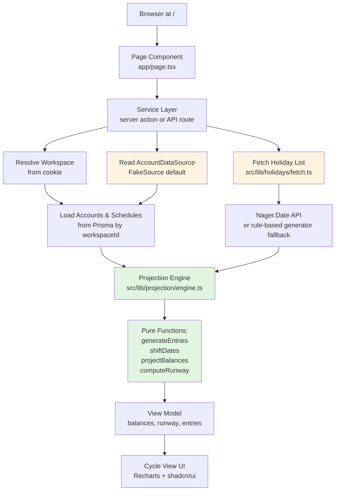

# Design Document: Projection Engine and Cycle View

## Overview

This design covers Spec 1 of the Runway app: a pure-function projection engine that generates future entries, computes pay-cycle boundaries, projects available and ledger balances with deposit holds and business-day shifting, calculates runway, and a cycle view that renders those projections using Recharts.

The projection engine lives in `src/lib/projection/` as a set of pure functions with no I/O and no side effects. All external data—accounts, schedules, holidays, and the current date—flows in as function arguments. The cycle view at `/` (App Router) reads through an AccountDataSource interface and passes that data plus a pre-fetched holiday list to the engine, then renders the output.

**Key Design Principles:**
- **Pure functions only** in the projection engine: no database, no network, no mutation
- **Money as integer cents** everywhere: no floats, no rounding errors
- **Data source abstraction**: FakeSource (demo data) as the default; Plaid and manual entry arrive in later specs
- **Business-day awareness**: weekend and holiday shifting baked into entry generation
- **Available vs. ledger distinction**: deposit holds modeled explicitly to show spendable money vs. bank records

## Architecture

### Data Flow Diagram



**Flow explanation:**

1. **Browser** requests the root page `/`
2. **Page Component** (`app/page.tsx`) calls a server action or API route
3. **Service Layer** resolves the workspace from the HTTP-only cookie, reads accounts and schedules through the AccountDataSource, and fetches the holiday list
4. **Holiday Service** (`src/lib/holidays/fetch.ts`) checks cache, fetches from Nager.Date if needed, falls back to the rule-based Federal Reserve generator on error. Holidays are fetched for every calendar year the projection range touches (typically 2 to 3 years; each year is cached by the Next fetch cache)
5. **Projection Engine** receives all data as arguments (accounts, schedules, holiday list, current date), generates entries, shifts dates, projects balances, computes runway
6. **View Model** is returned to the page with projected balances by date, runway number and date, upcoming entries, and any warnings
7. **Cycle View** renders the view model using Recharts for the balance chart and shadcn/ui for the timeline and warnings

### Component Boundaries

**Service Layer** (server-side, handles I/O):
- `app/api/projection/route.ts` (API route, receives `?today=YYYY-MM-DD` query param)
- `app/page.tsx` (client component that calls API with current date)
- Resolves workspace from cookie (`src/lib/workspace.ts`)
- Reads accounts, schedules, and one-off entries from Prisma
- Reads through AccountDataSource interface
- Fetches holidays via `src/lib/holidays/fetch.ts`
- Calls projection engine with all inputs
- Returns view model to client

**Projection Engine** (pure functions, no I/O):
- `src/lib/projection/types.ts` — domain types
- `src/lib/projection/engine.ts` — entry generation, balance projection, runway
- `src/lib/projection/cycle.ts` — pay-cycle boundary logic
- `src/lib/projection/dates.ts` — pure UTC date-only helpers on 'YYYY-MM-DD' strings: `addDays(date, n)`, `dayOfWeek(date)` (0=Sunday, via `Date.UTC` + `getUTCDay`), `daysInMonth(year, month)`
- `src/lib/projection/shift.ts` — business-day date shifting
- `src/lib/projection/runway.ts` — runway calculation

**Holiday Service** (I/O, separate from engine):
- `src/lib/holidays/fetch.ts` — fetch, cache, fallback
- `src/lib/holidays/generator.ts` — rule-based Federal Reserve holiday generator (fallback)
- `src/lib/holidays/years.ts` — pure helper listing the calendar years a date range touches

**Data Sources** (behind interface):
- `src/sources/interface.ts` — AccountDataSource interface
- `src/sources/fake-source.ts` — demo data (default)

**UI Components**:
- `src/app/page.tsx` — cycle view page
- `src/components/balance-chart.tsx` — Recharts chart
- `src/components/entry-timeline.tsx` — upcoming entries list
- `src/components/runway-callout.tsx` — runway number and date
- `src/components/low-balance-warning.tsx` — threshold warning

## Data Models

### Prisma Schema

```prisma
// prisma/schema.prisma

generator client {
  provider = "prisma-client-js"
}

datasource db {
  provider = "postgresql"
  url      = env("DATABASE_URL")
}

model Workspace {
  id            String    @id @default(cuid())
  createdAt     DateTime  @default(now())
  lastActivity  DateTime  @default(now())
  
  // User preferences scoped to this workspace
  lowBalanceThresholdCents Int?
  projectionHorizonDays     Int  @default(30)
  
  accounts      Account[]
  schedules     Schedule[]
  oneOffEntries OneOffEntry[]
  
  @@index([lastActivity]) // for cleanup of inactive workspaces
}

model Account {
  id                String   @id @default(cuid())
  workspaceId       String
  workspace         Workspace @relation(fields: [workspaceId], references: [id], onDelete: Cascade)
  
  name              String   // "Chase Checking", "Savings"
  type              AccountType
  isPrimary         Boolean  @default(false)
  
  // Current balances from source (integer cents)
  ledgerBalanceCents     Int
  availableBalanceCents  Int? // null when institution doesn't report it
  
  createdAt         DateTime @default(now())
  updatedAt         DateTime @updatedAt
  
  schedules         Schedule[]
  oneOffEntries     OneOffEntry[]
  
  @@unique([workspaceId, name])
  @@index([workspaceId, isPrimary])
}

enum AccountType {
  CHECKING
  SAVINGS
  INVESTMENT
  CREDIT_CARD
}

model Schedule {
  id                String    @id @default(cuid())
  workspaceId       String
  workspace         Workspace @relation(fields: [workspaceId], references: [id], onDelete: Cascade)
  
  name              String    // "Rent", "Paycheck"
  accountId         String
  account           Account   @relation(fields: [accountId], references: [id], onDelete: Cascade)
  
  intervalType      IntervalType
  intervalValue     Int       // N in "every N days/weeks/months"
  daysOfMonth       Int[]     // for DAYS_OF_MONTH type: [1, 15] for 1st and 15th
  
  startDate         DateTime  @db.Date // first occurrence (date only, no time)
  estimatedAmountCents Int    // positive for income, negative for debits
  
  entryType         EntryType // INCOME or DEBIT
  
  createdAt         DateTime  @default(now())
  updatedAt         DateTime  @updatedAt
  
  @@index([workspaceId, accountId])
}

enum IntervalType {
  DAYS           // every N days
  WEEKS          // every N weeks
  MONTHS         // every N months
  DAYS_OF_MONTH  // specific days: 1st, 15th, etc.
}

enum EntryType {
  INCOME
  DEBIT
}

model OneOffEntry {
  id                String    @id @default(cuid())
  workspaceId       String
  workspace         Workspace @relation(fields: [workspaceId], references: [id], onDelete: Cascade)
  
  accountId         String
  account           Account   @relation(fields: [accountId], references: [id], onDelete: Cascade)
  
  postDate          DateTime  @db.Date // original scheduled date (date only)
  
  estimatedAmountCents Int    // always present
  actualAmountCents    Int?   // null until posted
  
  status            EntryStatus @default(PLANNED)
  entryType         EntryType
  
  // Deposit hold modeling
  holdReleaseDate   DateTime? @db.Date // when deposit becomes available (date only)
  isHoldEstimated   Boolean   @default(false) // true if we estimated the hold date
  
  description       String?
  
  createdAt         DateTime  @default(now())
  updatedAt         DateTime  @updatedAt
  
  @@index([workspaceId, accountId, postDate])
  @@index([workspaceId, status])
}

enum EntryStatus {
  PLANNED   // scheduled, not yet seen
  PENDING   // seen by source but not posted
  POSTED    // settled
  SKIPPED   // user excluded
}
```

**Schema Rationale:**

- **workspaceId on every model**: all queries filter by workspace; cascade delete keeps data isolated
- **Integer cents everywhere**: `ledgerBalanceCents`, `availableBalanceCents`, `estimatedAmountCents`, `actualAmountCents`, `lowBalanceThresholdCents`
- **@db.Date for date fields**: `startDate`, `postDate`, `holdReleaseDate` — calendar dates without time component
- **Explicit EntryType enum**: INCOME vs DEBIT drives business-day shifting direction and pay-cycle boundaries
- **holdReleaseDate + isHoldEstimated**: models deposit holds; `isHoldEstimated` signals UI to label it
- **OneOffEntry model only**: generated planned entries from schedules are computed at projection time, not stored
- **Flexible interval types**: DAYS, WEEKS, MONTHS (every N), DAYS_OF_MONTH (specific days like 1st and 15th)
- **isPrimary on Account**: exactly one per workspace; runway computed on this account
```

**Schema Rationale:**

- **workspaceId on every model**: all queries filter by workspace; cascade delete keeps data isolated
- **Integer cents everywhere**: `ledgerBalanceCents`, `availableBalanceCents`, `estimatedAmountCents`, `actualAmountCents`, `lowBalanceThresholdCents`
- **Explicit EntryType enum**: INCOME vs DEBIT drives business-day shifting direction and pay-cycle boundaries
- **holdReleaseDate + isHoldEstimated**: models deposit holds; `isHoldEstimated` signals UI to label it
- **shiftedPostDate alongside postDate**: engine computes shifted date once, stores both for display
- **Flexible interval types**: DAYS, WEEKS, MONTHS (every N), DAYS_OF_MONTH (specific days like 1st and 15th)
- **nullable scheduleId**: one-off income entries have no schedule
- **isPrimary on Account**: exactly one per workspace; runway computed on this account

## Components and Interfaces

### AccountDataSource Interface

**Location:** `src/sources/interface.ts`

```typescript
// src/sources/interface.ts

export interface Account {
  id: string;
  name: string;
  type: 'CHECKING' | 'SAVINGS' | 'INVESTMENT' | 'CREDIT_CARD';
  isPrimary: boolean;
  ledgerBalanceCents: number;
  availableBalanceCents: number | null; // null when institution doesn't report
}

export interface Transaction {
  id: string;
  accountId: string;
  date: Date;
  amountCents: number; // positive = money in, negative = money out
  description: string;
  status: 'PENDING' | 'POSTED';
  holdReleaseDate?: Date; // optional, present if known
}

export interface AccountDataSource {
  getAccounts(): Promise<Account[]>;
  syncTransactions(cursor?: string): Promise<{
    added: Transaction[];
    modified: Transaction[];
    removed: string[];
    nextCursor: string;
  }>;
}
```

**FakeSource Implementation**

**Location:** `src/sources/fake-source.ts`

```typescript
// src/sources/fake-source.ts

import { AccountDataSource, Account, Transaction } from './interface';

export class FakeSource implements AccountDataSource {
  async getAccounts(): Promise<Account[]> {
    return [
      {
        id: 'fake-checking',
        name: 'Demo Checking',
        type: 'CHECKING',
        isPrimary: true,
        ledgerBalanceCents: 160000, // $1,600.00
        availableBalanceCents: 150000, // $1,500.00 ($100 gap: $60 pending debit + $40 deposit on hold)
      },
      {
        id: 'fake-savings',
        name: 'Demo Savings',
        type: 'SAVINGS',
        isPrimary: false,
        ledgerBalanceCents: 512000, // $5,120.00
        availableBalanceCents: 512000,
      },
    ];
  }
  
  async syncTransactions(cursor?: string): Promise<{
    added: Transaction[];
    modified: Transaction[];
    removed: string[];
    nextCursor: string;
  }> {
    // For Spec 1, transactions aren't synced yet (no Plaid)
    // Return empty sync result
    return {
      added: [],
      modified: [],
      removed: [],
      nextCursor: cursor || 'fake-cursor-0',
    };
  }
}
```

**Rationale:**
- FakeSource returns the same data on every call, suitable for demo and unit tests
- Available balance is lower than ledger (simulates pending debit + held deposit)
- syncTransactions returns empty for Spec 1 (transactions arrive in Spec 3 with Plaid)

### Projection Engine Types

**Location:** `src/lib/projection/types.ts`

```typescript
// src/lib/projection/types.ts

export type EntryDirection = 'INCOME' | 'DEBIT';

export interface Schedule {
  id: string;
  name: string;
  accountId: string;
  intervalType: 'DAYS' | 'WEEKS' | 'MONTHS' | 'DAYS_OF_MONTH';
  intervalValue: number;
  daysOfMonth: number[]; // for DAYS_OF_MONTH type
  startDate: string; // 'YYYY-MM-DD'
  estimatedAmountCents: number;
  entryType: EntryDirection;
}

export interface Entry {
  id: string;
  accountId: string;
  scheduleId: string | null;
  postDate: string; // 'YYYY-MM-DD'
  shiftedPostDate: string; // 'YYYY-MM-DD', computed at projection time
  estimatedAmountCents: number;
  actualAmountCents: number | null;
  status: 'PLANNED' | 'PENDING' | 'POSTED' | 'SKIPPED';
  entryType: EntryDirection;
  holdReleaseDate?: string; // 'YYYY-MM-DD'
  isHoldEstimated?: boolean;
  description?: string;
}

export interface ProjectionInput {
  accounts: {
    id: string;
    isPrimary: boolean;
    ledgerBalanceCents: number;
    availableBalanceCents: number | null;
  }[];
  schedules: Schedule[];
  oneOffEntries: Entry[]; // from database (one-off entries only)
  holidays: string[]; // 'YYYY-MM-DD' strings, pre-fetched
  currentDate: string; // 'YYYY-MM-DD', projection start date
  projectionHorizonDays: number;
}

export interface ProjectedBalance {
  date: string; // 'YYYY-MM-DD'
  ledgerBalanceCents: number;
  availableBalanceCents: number;
  isEstimated: boolean; // true if available balance was estimated
}

export interface RunwayResult {
  lowestBalanceCents: number;
  lowestBalanceDate: string; // 'YYYY-MM-DD'
  isBeforePayday: boolean; // true if bounded by next income, false if horizon
  projectionEndDate: string; // 'YYYY-MM-DD'
}

export interface PayCycle {
  startDate: string; // 'YYYY-MM-DD'
  endDate: string; // 'YYYY-MM-DD', day before next income (or projection end)
  incomeEntryId: string | null; // the income entry that starts this cycle
}

export interface ProjectionOutput {
  balances: ProjectedBalance[];
  runway: RunwayResult | null;
  upcomingEntries: Entry[]; // entries with shiftedPostDate >= currentDate
  payCycles: PayCycle[];
  warnings: {
    belowThreshold?: {
      thresholdCents: number;
      lowestBalanceCents: number;
      date: string; // 'YYYY-MM-DD'
    };
    overdueEntries?: Entry[];
    availableBalanceDifference?: {
      reason: string; // e.g., "$500 deposit on hold until Oct 27"
    };
  };
}
```

### Projection Engine Function Signatures

**Location:** `src/lib/projection/engine.ts`

```typescript
// src/lib/projection/engine.ts

import {
  ProjectionInput,
  ProjectionOutput,
  Entry,
  Schedule,
  ProjectedBalance,
  PayCycle,
  RunwayResult,
} from './types';

/**
 * Main projection function: generates entries, shifts dates, projects balances, computes runway.
 * Pure function: identical inputs yield identical outputs, no side effects.
 * All dates are 'YYYY-MM-DD' strings.
 */
export function projectCashFlow(input: ProjectionInput): ProjectionOutput {
  // Implementation order:
  // 1. Generate entries from schedules through projection end
  // 2. Merge with one-off entries from database
  // 3. Shift dates for weekends and holidays (compute shiftedPostDate)
  // 4. Compute pay-cycle boundaries
  // 5. Project balances (ledger and available, with holds)
  // 6. Compute runway
  // 7. Build warnings
  // 8. Return view model
}

/**
 * Generate future entries from a schedule through the projection end date.
 * Handles month-end clamping (29-31 in short months).
 * Returns entries with postDate; shiftedPostDate computed separately.
 * All dates are 'YYYY-MM-DD' strings.
 */
export function generateEntries(
  schedule: Schedule,
  startDate: string, // 'YYYY-MM-DD'
  endDate: string,   // 'YYYY-MM-DD'
  holidays: string[] // 'YYYY-MM-DD' strings
): Entry[] {
  // Returns array of entries, each with:
  // - postDate (before shifting)
  // - shiftedPostDate (computed by shiftDate)
  // - estimatedAmountCents
  // - status: PLANNED
}

/**
 * Clamp day-of-month to the last day of short months.
 * E.g., day 31 in February becomes February 28 (or 29 in leap year).
 */
export function clampDayOfMonth(year: number, month: number, day: number): number {
  // month is 0-indexed (0=Jan, 1=Feb, ...)
  const daysInMonth = new Date(Date.UTC(year, month + 1, 0)).getUTCDate();
  return Math.min(day, daysInMonth);
}

/**
 * Shift a date to the next/prior business day if it falls on weekend or holiday.
 * Direction: 'DEBIT' → next business day, 'INCOME' → prior business day.
 * Pure function: takes holiday list as argument, performs no I/O.
 * All dates are 'YYYY-MM-DD' strings.
 */
export function shiftDate(
  date: string,      // 'YYYY-MM-DD'
  direction: 'INCOME' | 'DEBIT',
  holidays: string[] // 'YYYY-MM-DD' strings
): string {
  // Returns shifted date (may equal input if already a business day)
}

/**
 * Check if a date is a business day (not Saturday, Sunday, or in holiday list).
 * Date is 'YYYY-MM-DD' string.
 */
export function isBusinessDay(date: string, holidays: string[]): boolean {
  const d = new Date(date + 'T00:00:00Z');
  const dayOfWeek = d.getUTCDay();
  if (dayOfWeek === 0 || dayOfWeek === 6) return false; // Sunday or Saturday
  
  return !holidays.includes(date);
}

/**
 * Compute pay-cycle boundaries from income entries.
 * Each cycle spans from one income entry to the day before the next.
 * All dates are 'YYYY-MM-DD' strings.
 */
export function computePayCycles(
  entries: Entry[],
  currentDate: string,      // 'YYYY-MM-DD'
  projectionEndDate: string // 'YYYY-MM-DD'
): PayCycle[] {
  // Returns array of PayCycle objects
}

/**
 * Project balances (ledger and available) for each day from start to end.
 * Handles deposit holds, pending debits, overdue entries, estimated available balance.
 * All dates are 'YYYY-MM-DD' strings.
 */
export function projectBalances(
  startingLedgerCents: number,
  startingAvailableCents: number | null,
  entries: Entry[],
  startDate: string,  // 'YYYY-MM-DD'
  endDate: string     // 'YYYY-MM-DD'
): ProjectedBalance[] {
  // Returns array of ProjectedBalance, one per day
}

/**
 * Estimate available balance when institution reports null.
 * Formula: ledger - pending debits - posted-but-held deposits.
 */
export function estimateAvailableBalance(
  ledgerBalanceCents: number,
  entries: Entry[]
): number {
  // Returns estimated available balance in cents
}

/**
 * Compute runway: lowest available balance before next income (or within horizon).
 * Returns null if no primary account.
 * All dates are 'YYYY-MM-DD' strings.
 */
export function computeRunway(
  balances: ProjectedBalance[],
  nextIncomeDate: string | null, // 'YYYY-MM-DD'
  projectionEndDate: string      // 'YYYY-MM-DD'
): RunwayResult | null {
  // Finds lowest available balance and its date
  // If tie, returns earliest date
}
```

### Order of Operations

The projection engine follows this sequence (implemented in `projectCashFlow`):

1. **Determine projection end date**
   - If future income is scheduled: use next income's shifted post date + one full cycle
   - If no future income: use currentDate + projectionHorizonDays

2. **Generate entries from schedules**
   - Call `generateEntries` for each schedule from currentDate to projection end
   - Apply month-end clamping (days 29-31 in short months)

3. **Merge one-off entries**
   - Include one-off entries from database (pending, overdue planned, user-logged)

4. **Shift dates**
   - Call `shiftDate` for each entry based on entryType
   - Compute shiftedPostDate from postDate

5. **Compute pay cycles**
   - Call `computePayCycles` to find cycle boundaries from income entries

6. **Estimate available balance if needed**
   - If primary account's availableBalanceCents is null, call `estimateAvailableBalance`

7. **Project balances**
   - Call `projectBalances` with starting balances and all entries
   - Apply entries on their shiftedPostDate
   - For future deposits with holdReleaseDate: add to ledger on shiftedPostDate, add to available on holdReleaseDate
   - For posted deposits with holdReleaseDate: already in ledger, add to available on holdReleaseDate only
   - For future debits: subtract from both on shiftedPostDate
   - For pending debits: subtract from ledger only on expected post date (available already reflects them)
   - For overdue entries: apply at projection start date

8. **Compute runway**
   - Call `computeRunway` with balances and next income date
   - Find lowest available balance before next income (or within horizon)
   - On tie, return earliest date

9. **Build warnings**
   - Check if runway < lowBalanceThresholdCents (if threshold set)
   - Check for overdue entries
   - Check if ledger != available and explain why (held deposit or pending debit)

10. **Return ProjectionOutput**
    - Includes balances, runway, upcoming entries, pay cycles, warnings

## Current Date Transport

The projection engine needs the visitor's current calendar date. This flows from client to server:

**Client Component** (`app/page.tsx`):

```typescript
'use client';

import { useEffect, useState } from 'react';
import { ProjectionOutput } from '@/lib/projection/types';

export default function CyclePage() {
  const [projection, setProjection] = useState<ProjectionOutput | null>(null);
  const [loading, setLoading] = useState(true);
  const [error, setError] = useState<string | null>(null);
  
  useEffect(() => {
    async function fetchProjection() {
      try {
        setLoading(true);
        setError(null);
        
        // Visitor's LOCAL calendar date as YYYY-MM-DD. The 'en-CA' locale formats dates as YYYY-MM-DD.
        // Do not use toISOString(): it converts to UTC and returns tomorrow's date for evening visitors west of UTC.
        const today = new Date().toLocaleDateString('en-CA');
        
        const response = await fetch(`/api/projection?today=${today}`);
        
        if (!response.ok) {
          throw new Error('Failed to fetch projection');
        }
        
        const data = await response.json();
        setProjection(data);
      } catch (err) {
        setError(err instanceof Error ? err.message : 'Unknown error');
      } finally {
        setLoading(false);
      }
    }
    
    fetchProjection();
  }, []);
  
  if (loading) return <LoadingState />;
  if (error) return <ErrorState message={error} />;
  if (!projection) return <EmptyState />;
  
  return (
    <div>
      <RunwayCallout runway={projection.runway} />
      <BalanceChart balances={projection.balances} cycles={projection.payCycles} />
      <EntryTimeline entries={projection.upcomingEntries} />
      {projection.warnings.belowThreshold && (
        <LowBalanceWarning warning={projection.warnings.belowThreshold} />
      )}
    </div>
  );
}
```

**API Route** (`app/api/projection/route.ts`):

```typescript
import { NextRequest, NextResponse } from 'next/server';
import { prisma } from '@/lib/db';
import { projectCashFlow } from '@/lib/projection/engine';
import { fetchHolidays } from '@/lib/holidays/fetch';
import { resolveWorkspace } from '@/lib/workspace';
import { addDays } from '@/lib/projection/dates';
import { calendarYearsTouched } from '@/lib/holidays/years';

// Prisma @db.Date values are UTC-midnight Dates, so toISOString().split('T')[0]
// yields the stored calendar date (no timezone drift).
const toDateOnly = (d: Date): string => d.toISOString().split('T')[0];

export async function GET(request: NextRequest) {
  try {
    const { searchParams } = new URL(request.url);
    const today = searchParams.get('today');
    
    if (!today || !/^\d{4}-\d{2}-\d{2}$/.test(today)) {
      return NextResponse.json(
        { error: 'Invalid date format. Expected YYYY-MM-DD.' },
        { status: 400 }
      );
    }
    
    // Resolve workspace from cookie
    const workspace = await resolveWorkspace(request);
    
    // Load data for projection
    const [accounts, schedules, oneOffEntries] = await Promise.all([
      prisma.account.findMany({ where: { workspaceId: workspace.id } }),
      prisma.schedule.findMany({ where: { workspaceId: workspace.id } }),
      prisma.oneOffEntry.findMany({ where: { workspaceId: workspace.id } }),
    ]);
    
    // Range the projection can touch:
    //  - 7 days back: an income entry near Jan 1 can shift backward across the year boundary
    //  - forward: the next income is at most 366 days away for any schedule (Req 4.1 bounds) plus one
    //    full cycle (<= 366 days) = 732 days; one-off entries dated later extend the range; +7 days of shift slack
    const MAX_PROJECTION_SPAN_DAYS = 732;
    const latestKnownDate = oneOffEntries.reduce(
      (max, e) => { const d = toDateOnly(e.holdReleaseDate ?? e.postDate); return d > max ? d : max; },
      addDays(today, MAX_PROJECTION_SPAN_DAYS),
    );
    const years = calendarYearsTouched(addDays(today, -7), addDays(latestKnownDate, 7));
    const holidays = (await Promise.all(years.map(fetchHolidays))).flat();
    
    // Call projection engine
    const projection = projectCashFlow({
      accounts: accounts.map(a => ({
        id: a.id,
        isPrimary: a.isPrimary,
        ledgerBalanceCents: a.ledgerBalanceCents,
        availableBalanceCents: a.availableBalanceCents,
      })),
      schedules: schedules.map(s => ({
        id: s.id,
        name: s.name,
        accountId: s.accountId,
        intervalType: s.intervalType,
        intervalValue: s.intervalValue,
        daysOfMonth: s.daysOfMonth,
        startDate: toDateOnly(s.startDate),
        estimatedAmountCents: s.estimatedAmountCents,
        entryType: s.entryType,
      })),
      oneOffEntries: oneOffEntries.map(e => ({
        id: e.id,
        accountId: e.accountId,
        scheduleId: null,
        postDate: toDateOnly(e.postDate),
        shiftedPostDate: toDateOnly(e.postDate), // computed in engine
        estimatedAmountCents: e.estimatedAmountCents,
        actualAmountCents: e.actualAmountCents,
        status: e.status,
        entryType: e.entryType,
        holdReleaseDate: e.holdReleaseDate ? toDateOnly(e.holdReleaseDate) : undefined,
        isHoldEstimated: e.isHoldEstimated,
        description: e.description ?? undefined,
      })),
      holidays,
      currentDate: today,
      projectionHorizonDays: workspace.projectionHorizonDays,
    });
    
    // Update workspace lastActivity
    await prisma.workspace.update({
      where: { id: workspace.id },
      data: { lastActivity: new Date() },
    });
    
    return NextResponse.json(projection);
  } catch (error) {
    console.error('Projection error:', error);
    return NextResponse.json(
      { error: 'Projection failed. Please try again.' },
      { status: 500 }
    );
  }
}
```

## Workspace Cleanup

Inactive workspaces (no activity for 30 days) are deleted via a daily Vercel Cron job.

**Cron Route** (`app/api/cron/cleanup/route.ts`):

```typescript
import { NextRequest, NextResponse } from 'next/server';
import { prisma } from '@/lib/db';

export async function GET(request: NextRequest) {
  // Verify Vercel Cron secret
  const authHeader = request.headers.get('authorization');
  if (authHeader !== `Bearer ${process.env.CRON_SECRET}`) {
    return NextResponse.json({ error: 'Unauthorized' }, { status: 401 });
  }
  
  try {
    const thirtyDaysAgo = new Date();
    thirtyDaysAgo.setDate(thirtyDaysAgo.getDate() - 30);
    
    const result = await prisma.workspace.deleteMany({
      where: {
        lastActivity: {
          lt: thirtyDaysAgo,
        },
      },
    });
    
    console.log(`Deleted ${result.count} inactive workspaces`);
    
    return NextResponse.json({ deleted: result.count });
  } catch (error) {
    console.error('Cleanup error:', error);
    return NextResponse.json(
      { error: 'Cleanup failed' },
      { status: 500 }
    );
  }
}
```

**Vercel Configuration** (`vercel.json`):

```json
{
  "crons": [
    {
      "path": "/api/cron/cleanup",
      "schedule": "0 2 * * *"
    }
  ]
}
```

### Holiday Service

**Location:** `src/lib/holidays/fetch.ts`

```typescript
// src/lib/holidays/fetch.ts

import { generateFederalHolidays } from './generator';

/**
 * Fetch federal holidays for a given year.
 * Fetches from Nager.Date with Next.js fetch cache (7 day revalidation),
 * falls back to rule-based generator on error.
 * Returns array of 'YYYY-MM-DD' strings.
 */
export async function fetchHolidays(year: number): Promise<string[]> {
  try {
    // Use Next.js fetch cache with 7-day revalidation
    const response = await fetch(
      `https://date.nager.at/api/v3/PublicHolidays/${year}/US`,
      { 
        next: { revalidate: 604800 }, // 7 days in seconds
        signal: AbortSignal.timeout(5000), // 5-second timeout
      }
    );
    
    if (!response.ok) {
      throw new Error(`HTTP ${response.status}`);
    }
    
    const data = await response.json();
    
    if (!Array.isArray(data) || data.length === 0) {
      throw new Error('Empty or invalid response');
    }
    
    // Filter to nationwide holidays only (no state-level)
    const holidays = data
      .filter((h: any) => h.global === true)
      .map((h: any) => applyObservanceRulesToISO(h.date));
    
    return holidays;
    
  } catch (error) {
    console.warn(`Holiday fetch failed for ${year}, using rule-based generator:`, error);
    // Fall back to rule-based generator
    return generateFederalHolidays(year);
  }
}

/**
 * Apply Federal Reserve observance rules to an ISO date string from Nager.Date.
 * Sunday → observed on following Monday
 * Saturday → NOT observed on Friday (Fed is open)
 * Returns 'YYYY-MM-DD'.
 */
function applyObservanceRulesToISO(isoDate: string): string {
  const date = new Date(isoDate + 'T00:00:00Z');
  const dayOfWeek = date.getUTCDay();
  
  if (dayOfWeek === 0) {
    // Sunday → Monday
    date.setUTCDate(date.getUTCDate() + 1);
  }
  
  // Saturday → return as-is (Fed is open Friday)
  return date.toISOString().split('T')[0];
}
```
```

**Location:** `src/lib/holidays/generator.ts`

```typescript
// src/lib/holidays/generator.ts

/**
 * Generate the 11 Federal Reserve holidays for any year.
 * Applies Sunday→Monday observance rule. Saturday holidays remain on Saturday
 * (Federal Reserve is open the preceding Friday).
 * 
 * Holidays: New Year's Day, MLK Jr Day, Presidents Day, Memorial Day,
 * Juneteenth, Independence Day, Labor Day, Columbus Day, Veterans Day,
 * Thanksgiving, Christmas.
 */
export function generateFederalHolidays(year: number): string[] {
  const holidays: string[] = [];
  
  // New Year's Day (January 1)
  holidays.push(applyObservanceRules(year, 0, 1));
  
  // MLK Jr Day (3rd Monday of January)
  holidays.push(nthWeekdayOfMonth(year, 0, 1, 3)); // January, Monday, 3rd
  
  // Presidents Day (3rd Monday of February)
  holidays.push(nthWeekdayOfMonth(year, 1, 1, 3)); // February, Monday, 3rd
  
  // Memorial Day (last Monday of May)
  holidays.push(lastWeekdayOfMonth(year, 4, 1)); // May, Monday
  
  // Juneteenth (June 19)
  holidays.push(applyObservanceRules(year, 5, 19));
  
  // Independence Day (July 4)
  holidays.push(applyObservanceRules(year, 6, 4));
  
  // Labor Day (1st Monday of September)
  holidays.push(nthWeekdayOfMonth(year, 8, 1, 1)); // September, Monday, 1st
  
  // Columbus Day (2nd Monday of October)
  holidays.push(nthWeekdayOfMonth(year, 9, 1, 2)); // October, Monday, 2nd
  
  // Veterans Day (November 11)
  holidays.push(applyObservanceRules(year, 10, 11));
  
  // Thanksgiving (4th Thursday of November)
  holidays.push(nthWeekdayOfMonth(year, 10, 4, 4)); // November, Thursday, 4th
  
  // Christmas (December 25)
  holidays.push(applyObservanceRules(year, 11, 25));
  
  return holidays;
}

/**
 * Apply Federal Reserve observance rules to a fixed date.
 * Sunday → following Monday. Saturday → unchanged (Fed is open Friday).
 * Returns 'YYYY-MM-DD'.
 */
function applyObservanceRules(year: number, month: number, day: number): string {
  const date = new Date(Date.UTC(year, month, day));
  const dayOfWeek = date.getUTCDay();
  
  if (dayOfWeek === 0) {
    // Sunday → Monday
    date.setUTCDate(date.getUTCDate() + 1);
  }
  // Saturday stays Saturday (Fed is open Friday)
  
  return formatDateOnly(date);
}

/**
 * Find the nth occurrence of a weekday in a month.
 * weekday: 0=Sunday, 1=Monday, ..., 6=Saturday
 * Returns 'YYYY-MM-DD'.
 */
function nthWeekdayOfMonth(year: number, month: number, weekday: number, n: number): string {
  const firstDay = new Date(Date.UTC(year, month, 1));
  const firstWeekday = firstDay.getUTCDay();
  
  // Calculate offset to first occurrence of target weekday
  let offset = (weekday - firstWeekday + 7) % 7;
  // Add weeks to get nth occurrence
  const date = 1 + offset + (n - 1) * 7;
  
  return formatDateOnly(new Date(Date.UTC(year, month, date)));
}

/**
 * Find the last occurrence of a weekday in a month.
 * Returns 'YYYY-MM-DD'.
 */
function lastWeekdayOfMonth(year: number, month: number, weekday: number): string {
  // Start from last day of month
  const lastDay = new Date(Date.UTC(year, month + 1, 0));
  const lastDate = lastDay.getUTCDate();
  const lastWeekday = lastDay.getUTCDay();
  
  // Calculate offset back to last occurrence of target weekday
  const offset = (lastWeekday - weekday + 7) % 7;
  const date = lastDate - offset;
  
  return formatDateOnly(new Date(Date.UTC(year, month, date)));
}

/**
 * Format a Date as 'YYYY-MM-DD'.
 */
function formatDateOnly(date: Date): string {
  return date.toISOString().split('T')[0];
}
```

**Location:** `src/lib/holidays/years.ts` (pure, no I/O)

```typescript
/** Every calendar year in [startDate, endDate], inclusive. Dates are 'YYYY-MM-DD'. */
export function calendarYearsTouched(startDate: string, endDate: string): number[] {
  const first = Number(startDate.slice(0, 4));
  const last = Number(endDate.slice(0, 4));
  return Array.from({ length: last - first + 1 }, (_, i) => first + i);
}
```

**Rationale:**
- **Cache per year**: holidays don't change after fetching once
- **5-second timeout**: fail fast if Nager.Date is down
- **Observance rules**: match Federal Reserve (Sunday → Monday, Saturday stays Saturday)
- **Nationwide only**: filter `global === true` from Nager.Date to exclude state holidays
- **Rule-based fallback**: `generateFederalHolidays(year)` yields the 11 Federal Reserve holidays for any year

## Correctness Properties

*A property is a characteristic or behavior that should hold true across all valid executions of a system—essentially, a formal statement about what the system should do. Properties serve as the bridge between human-readable specifications and machine-verifiable correctness guarantees.*

### Property 1: Workspace data isolation

*For any* workspace and any set of database records, queries filtered by that workspace should return only records with that workspace's ID, never including records from other workspaces.

**Validates: Requirements 1.3**

### Property 2: Reset isolation

*For any* set of workspaces with data, resetting one workspace should delete all data for that workspace, reseed it with fresh demo data, and leave all other workspaces' data completely unchanged.

**Validates: Requirements 1.4**

### Property 3: FakeSource determinism

*For any* number of invocations of FakeSource.getAccounts(), the returned data should be identical across all calls, demonstrating that the source is deterministic and suitable for both demo and testing.

**Validates: Requirements 2.4**

### Property 4: Integer cents representation

*For any* money value stored, transmitted, or computed in the system (balances, amounts, thresholds), the value should be represented as an integer number of cents, never as a floating-point number.

**Validates: Requirements 3.1**

### Property 5: Exactly one primary account

*For any* workspace, the count of accounts marked as primary should equal exactly 1, never 0 or more than 1.

**Validates: Requirements 3.3**

### Property 6: Null available balance preservation

*For any* account where the data source reports a null available balance, the stored account should preserve that null value rather than converting it to zero or another default.

**Validates: Requirements 3.4**

### Property 7: Runway computed on primary account

*For any* set of accounts with one marked as primary, the runway calculation should use the primary account's available balance (or estimated available balance if null), never any other account's balance.

**Validates: Requirements 3.5**

### Property 8: Entry generation within bounds

*For any* schedule and projection end date, all entries generated from that schedule should have post dates that fall between the schedule start date and the projection end date (inclusive).

**Validates: Requirements 4.2**

### Property 9: Month-end clamping

*For any* schedule specifying day-of-month 29, 30, or 31, entries generated in months with fewer days should be placed on the last valid day of that month before business-day shifting is applied.

**Validates: Requirements 4.4**

### Property 10: Generated entry defaults

*For any* entry generated from a schedule with no actual amount recorded, the entry status should be PLANNED and the estimated amount should be an integer number of cents.

**Validates: Requirements 4.5**

### Property 11: Invalid interval rejection

*For any* schedule with an interval value that is zero, negative, or exceeds the bounds for its interval type (days > 365, weeks > 52, months > 12), schedule creation should fail with an error indicating the invalid value.

**Validates: Requirements 4.6**

### Property 12: Pay cycle boundaries from income

*For any* set of income entries ordered by shifted post date, each pay cycle should start at one income entry's shifted post date and end on the day before the next income entry's shifted post date.

**Validates: Requirements 5.1, 5.5**

### Property 13: Horizon-based projection end

*For any* projection with no future income entries scheduled, the projection end date should equal the current date plus the projection horizon days.

**Validates: Requirements 5.2**

### Property 14: Mid-cycle income splits cycle

*For any* pay cycle with a one-off income entry whose shifted post date falls between the cycle's start and end, the original cycle should be split into two cycles at that income entry's shifted post date.

**Validates: Requirements 5.4**

### Property 15: Daily balance projection

*For any* projection from start date to end date, there should be exactly one balance entry (ledger and available) for each calendar day in that inclusive range.

**Validates: Requirements 6.1**

### Property 16: Posted entries not double-applied

*For any* set of entries including posted entries, the posted entries should not affect projected balances (since they're already in the source-reported starting balance), except for posted deposits still on hold which are already in ledger but add to available on holdReleaseDate, and overdue planned entries which are handled separately.

**Validates: Requirements 6.3, 6.7**

### Property 17: Debit decreases both balances

*For any* planned debit entry, both the available balance and ledger balance should decrease by the debit amount on the entry's shifted post date.

**Validates: Requirements 6.4**

### Property 18: Simple deposit increases both balances

*For any* planned deposit entry with no hold release date, both the available balance and ledger balance should increase by the deposit amount on the entry's shifted post date.

**Validates: Requirements 6.5**

### Property 19: Held deposit splits into ledger and available

*For any* planned deposit entry with a hold release date, the ledger balance should increase by the deposit amount on the entry's shifted post date, and the available balance should increase by the deposit amount on the hold release date.

**Validates: Requirements 6.6**

### Property 20: Hold date estimation labeled

*For any* entry where the hold release date was estimated rather than user-provided, the isHoldEstimated flag should be true.

**Validates: Requirements 6.9**

### Property 21: Debit forward shifting

*For any* debit entry whose post date falls on a non-business day (Saturday, Sunday, or holiday), the shifted post date should be the next business day, skipping any consecutive non-business days.

**Validates: Requirements 7.2**

### Property 22: Income backward shifting

*For any* income entry whose post date falls on a non-business day (Saturday, Sunday, or holiday), the shifted post date should be the prior business day, skipping any consecutive non-business days.

**Validates: Requirements 7.3**

### Property 23: Both dates preserved

*For any* entry, both the original post date and the shifted post date should be stored and available for display, even when they are equal (i.e., the date was already a business day).

**Validates: Requirements 7.4**

### Property 24: Business day definition

*For any* calendar date and holiday list, the date should be classified as a business day if and only if it is not a Saturday, not a Sunday, and not present in the holiday list.

**Validates: Requirements 7.6**

### Property 25: Business day shift is identity

*For any* post date that is already a business day, the date-shifting function should return the same date unchanged.

**Validates: Requirements 7.7**

### Property 26: Sunday holiday observance

*For any* federal holiday that falls on a Sunday, the observed date for closure purposes should be the following Monday.

**Validates: Requirements 8.3**

### Property 27: Saturday holiday not observed Friday

*For any* federal holiday that falls on a Saturday, the observed date should remain Saturday (not shifted to the preceding Friday), because the Federal Reserve is open that Friday.

**Validates: Requirements 8.4**

### Property 28: Runway before income

*For any* projection with a future income entry scheduled, the runway amount should be the lowest projected available balance on the primary account from the projection start date up to (but not including) the next income entry's shifted post date.

**Validates: Requirements 9.1, 9.2**

### Property 29: Runway tie-breaking

*For any* projection where two or more dates share the lowest projected available balance, the runway date should be the earliest of those dates.

**Validates: Requirements 9.3**

### Property 30: Runway within horizon

*For any* projection with no future income entry scheduled, the runway amount should be the lowest projected available balance within the projection horizon days, and the label should indicate "within the next N days" rather than "before payday."

**Validates: Requirements 9.4**

### Property 31: Threshold warning display

*For any* projection where a low balance threshold is set and the computed runway falls below that threshold, a warning should be displayed showing the projected lowest available balance amount and the date it occurs.

**Validates: Requirements 10.1**

### Property 32: Negative runway warning

*For any* projection where the computed runway is a negative value, a warning should be displayed showing the projected lowest available balance amount and the date it occurs, regardless of whether a threshold is set.

**Validates: Requirements 10.2**

### Property 33: Threshold storage bounds

*For any* low balance threshold value stored in the system, the value should be an integer number of cents between 0 and 999,999,999 inclusive.

**Validates: Requirements 10.3**

### Property 34: No warning without trigger

*For any* projection where no low balance threshold is set and the computed runway is not negative, no low-balance warning should be displayed.

**Validates: Requirements 10.4**

### Property 35: Available balance estimation

*For any* account with a null available balance, the estimated available balance should equal the ledger balance minus all pending debit entry amounts minus all deposits currently on hold.

**Validates: Requirements 11.1, 11.3**

### Property 36: Estimated balance labeled

*For any* balance that was computed through estimation (because the source reported null), the isEstimated flag should be true to signal the UI to label it accordingly.

**Validates: Requirements 11.2**

### Property 37: Overdue entry application

*For any* planned entry whose shifted post date is earlier than the projection start date and which has no actual amount recorded, the entry's estimated amount should be applied to the projection at the projection start date.

**Validates: Requirements 12.1**

### Property 38: Overdue entry flagging

*For any* planned entry whose shifted post date is earlier than the projection start date and which has no actual amount recorded, the entry should be flagged as overdue for display in the entry timeline.

**Validates: Requirements 12.2**

### Property 39: Upcoming entries ordering

*For any* set of entries, the timeline of upcoming entries should include only entries whose shifted post date is on or after the current date, and they should be ordered by shifted post date in ascending order.

**Validates: Requirements 13.3**

### Property 40: Projection purity

*For any* projection input, calling the projection engine function multiple times with identical inputs should yield identical outputs, demonstrating that the function is pure with no side effects.

**Validates: Requirements 14.1**

### Property 41: Demo data relative dates

*For any* current date used as the projection start, all dates in the FakeSource demo data (entry post dates, hold release dates, schedule start dates) should be computed as relative offsets from that current date, ensuring the demo showcases all features regardless of when a reviewer visits.

**Validates: Requirements 15.8**

## Error Handling

### Holiday Fetch Errors

**Scenario:** Nager.Date API is unavailable, returns HTTP error, times out after 5 seconds, or returns malformed/empty data.

**Handling:**
1. `fetchHolidays()` wraps the fetch in a try-catch with a 5-second `AbortSignal.timeout(5000)`
2. On any error (network, HTTP status, timeout, empty result), logs a warning to console
3. Falls back to the rule-based generator (`generateFederalHolidays`)
4. Caches the fallback result so subsequent calls for that year don't retry the fetch
5. Projection continues normally with the fallback holiday list

**Rationale:** Holiday data is essential for correct date shifting, but the app should never fail if the external API is down. The rule-based fallback covers the 11 Federal Reserve holidays with correct observance rules.

### Invalid or Missing Workspace Cookie

**Scenario:** Cookie is missing, malformed, or references a workspace ID that doesn't exist.

**Handling:**
1. Service layer attempts to load workspace by ID from cookie
2. If load fails (null result), creates a new workspace with a fresh ID
3. Sets a new HTTP-only Secure SameSite=Lax cookie with 365-day max age
4. Seeds the new workspace with FakeSource demo data
5. Returns projection normally

**Rationale:** Every visitor should get a working demo immediately. Missing or invalid workspace is not an error—it's a new visitor.

### Projection Engine Errors

**Scenario:** Projection engine receives invalid inputs (e.g., no primary account, invalid dates, malformed entries).

**Handling:**
1. Engine functions validate inputs at the top and throw descriptive errors
2. Service layer wraps engine call in try-catch
3. On error, logs the error server-side and returns an error state to the client
4. Cycle View displays error state with message: "Projection failed. Please try again."
5. App continues to function (error is localized to projection, doesn't crash the page)

**Example validations:**
- If no primary account: return null runway (per spec), log warning
- If projection end date is before start date: throw error
- If holiday list is empty: proceed with empty list (weekends-only shifting)

**Rationale:** Projection errors should be visible but not catastrophic. The UI should degrade gracefully.

### Null Available Balance

**Scenario:** Institution reports ledger balance but no available balance (null).

**Handling:**
1. Store the null in the Account model (don't default to ledger or zero)
2. At projection time, detect null and call `estimateAvailableBalance()`
3. Estimation formula: `ledgerBalanceCents - sum(pending debit amounts) - sum(held deposit amounts)`
4. Set `isEstimated: true` on each projected balance using the estimate
5. UI labels estimated balances with "(estimated)" text

**Rationale:** Some institutions don't report available balance. Rather than failing, we estimate conservatively from ledger and known holds. The user sees the balance and knows it's estimated.

### Demo Data Seeding Errors

**Scenario:** Prisma create operations fail during demo data seeding (database unavailable, constraint violation).

**Handling:**
1. Seed function wraps all creates in try-catch
2. On error, rolls back the workspace creation transaction
3. Returns error to the service layer, which returns 500 to client
4. Client sees error page with "Unable to create demo workspace. Please refresh."

**Rationale:** Seeding errors are rare (only on first visit or reset) and indicate a database issue. Fail fast with a clear message.

## Testing Strategy

### Unit Tests (Vitest)

**Location:** `__tests__/projection/`

The projection engine's pure functions are thoroughly unit tested. Each test validates specific behavior or edge cases.

#### Month-End Clamping

**Test:** `clampDayOfMonth` function with days 29-31 across various months

```typescript
describe('clampDayOfMonth', () => {
  it('clamps day 31 to 28 in February (non-leap year)', () => {
    expect(clampDayOfMonth(2026, 1, 31)).toBe(28); // Feb 2026
  });
  
  it('clamps day 31 to 29 in February (leap year)', () => {
    expect(clampDayOfMonth(2024, 1, 31)).toBe(29); // Feb 2024
  });
  
  it('clamps day 31 to 30 in April', () => {
    expect(clampDayOfMonth(2026, 3, 31)).toBe(30); // April 2026
  });
  
  it('does not clamp day 31 in January', () => {
    expect(clampDayOfMonth(2026, 0, 31)).toBe(31); // Jan 2026
  });
});
```

**Feature: projection-engine-cycle-view, Property 9: Month-end clamping**

#### Three-Paycheck Month (Biweekly Income)

**Test:** `computePayCycles` with biweekly income spanning a three-paycheck month

```typescript
describe('computePayCycles with biweekly income', () => {
  it('produces three distinct cycles for a month with three paychecks', () => {
    const currentDate = '2026-01-01';
    const entries: Entry[] = [
      incomeEntry('2026-01-02'),  // First paycheck
      incomeEntry('2026-01-16'),  // Second paycheck
      incomeEntry('2026-01-30'),  // Third paycheck (same month!)
      incomeEntry('2026-02-13'),  // Next month
    ];
    
    const cycles = computePayCycles(entries, currentDate, '2026-02-28');
    
    expect(cycles).toHaveLength(3);
    expect(cycles[0].startDate).toEqual('2026-01-02');
    expect(cycles[0].endDate).toEqual('2026-01-15');
    expect(cycles[1].startDate).toEqual('2026-01-16');
    expect(cycles[1].endDate).toEqual('2026-01-29');
    expect(cycles[2].startDate).toEqual('2026-01-30');
    expect(cycles[2].endDate).toEqual('2026-02-12');
  });
});
```

**Feature: projection-engine-cycle-view, Property 12: Pay cycle boundaries from income**

#### Saturday vs Sunday Holiday Observance

**Test:** `applyObservanceRules` function with holidays on Saturday and Sunday

```typescript
describe('applyObservanceRules', () => {
  it('shifts Sunday holiday to Monday', () => {
    expect(applyObservanceRules('2027-07-04')).toEqual('2027-07-05'); // July 4, 2027 is Sunday → Monday
  });
  
  it('does NOT shift Saturday holiday to Friday', () => {
    expect(applyObservanceRules('2026-07-04')).toEqual('2026-07-04'); // July 4, 2026 is Saturday, unchanged
  });
});
```

**Feature: projection-engine-cycle-view, Property 26: Sunday holiday observance**  
**Feature: projection-engine-cycle-view, Property 27: Saturday holiday not observed Friday**

#### Pending → Posted (Ledger Only, Not Available)

**Test:** Balance projection with pending debit that's already reflected in available balance

```typescript
describe('projectBalances with pending debit', () => {
  it('subtracts pending debit from ledger only when it posts', () => {
    const startLedger = 1000_00;  // $1,000
    const startAvailable = 980_00; // $980 (pending $20 already deducted by source)
    
    const entries: Entry[] = [
      {
        id: 'pending-1',
        accountId: 'acc-1',
        scheduleId: null,
        postDate: '2026-01-05',
        shiftedPostDate: '2026-01-05',
        estimatedAmountCents: -20_00,
        actualAmountCents: null,
        status: 'PENDING',
        entryType: 'DEBIT',
      },
    ];
    
    const balances = projectBalances(
      startLedger,
      startAvailable,
      entries,
      '2026-01-01',
      '2026-01-10'
    );
    
    // Before post date: available already reflects pending, ledger does not
    const jan3 = balances.find(b => b.date === '2026-01-03')!;
    expect(jan3.ledgerBalanceCents).toBe(1000_00); // Unchanged
    expect(jan3.availableBalanceCents).toBe(980_00); // Already reflects pending
    
    // On post date: subtract from ledger only
    const jan5 = balances.find(b => b.date === '2026-01-05')!;
    expect(jan5.ledgerBalanceCents).toBe(980_00); // Now deducted
    expect(jan5.availableBalanceCents).toBe(980_00); // No change (already deducted)
  });
});
```

**Feature: projection-engine-cycle-view, Property 16: Posted entries not double-applied**

#### Held Deposit Release

**Test:** Balance projection with deposit on hold, released on a specific date

```typescript
describe('projectBalances with held deposit', () => {
  it('adds to ledger on post date, available on hold release date', () => {
    const startLedger = 1000_00;
    const startAvailable = 1000_00;
    
    const entries: Entry[] = [
      {
        id: 'deposit-1',
        accountId: 'acc-1',
        scheduleId: null,
        postDate: '2026-01-05',
        shiftedPostDate: '2026-01-05',
        estimatedAmountCents: 500_00,
        actualAmountCents: null,
        status: 'PLANNED',
        entryType: 'INCOME',
        holdReleaseDate: '2026-01-10',
      },
    ];
    
    const balances = projectBalances(
      startLedger,
      startAvailable,
      entries,
      '2026-01-01',
      '2026-01-15'
    );
    
    // On post date: ledger increases, available does not
    const jan5 = balances.find(b => b.date === '2026-01-05')!;
    expect(jan5.ledgerBalanceCents).toBe(1500_00); // +$500
    expect(jan5.availableBalanceCents).toBe(1000_00); // No change yet
    
    // On hold release date: available increases
    const jan10 = balances.find(b => b.date === '2026-01-10')!;
    expect(jan10.ledgerBalanceCents).toBe(1500_00); // Unchanged
    expect(jan10.availableBalanceCents).toBe(1500_00); // Now available
  });
  
  it('adds posted-but-held deposit to available only on hold release date', () => {
    const startLedger = 1000_00;   // $1,000 ledger
    const startAvailable = 960_00; // $960 available ($40 deposit already in ledger but held)
    
    const entries: Entry[] = [
      {
        id: 'held-1',
        accountId: 'acc-1',
        scheduleId: null,
        postDate: '2026-01-02',     // Already posted
        shiftedPostDate: '2026-01-02',
        estimatedAmountCents: 40_00, // $40 deposit
        actualAmountCents: 40_00,
        status: 'POSTED',
        entryType: 'INCOME',
        holdReleaseDate: '2026-01-08', // Releases in the future
      },
    ];
    
    const balances = projectBalances(
      startLedger,
      startAvailable,
      entries,
      '2026-01-01',
      '2026-01-15'
    );
    
    // Before hold release: ledger already has deposit, available does not
    const jan5 = balances.find(b => b.date === '2026-01-05')!;
    expect(jan5.ledgerBalanceCents).toBe(1000_00); // Already in ledger
    expect(jan5.availableBalanceCents).toBe(960_00); // Not yet available
    
    // On hold release date: available increases, ledger unchanged
    const jan8 = balances.find(b => b.date === '2026-01-08')!;
    expect(jan8.ledgerBalanceCents).toBe(1000_00); // No change
    expect(jan8.availableBalanceCents).toBe(1000_00); // +$40 now available
  });
});
```

**Feature: projection-engine-cycle-view, Property 19: Held deposit splits into ledger and available**

#### Ties in Lowest Balance (Earliest Date Wins)

**Test:** `computeRunway` with multiple dates at the same lowest balance

```typescript
describe('computeRunway tie-breaking', () => {
  it('returns earliest date when multiple dates share lowest balance', () => {
    const balances: ProjectedBalance[] = [
      { date: '2026-01-05', availableBalanceCents: 200_00, ledgerBalanceCents: 200_00, isEstimated: false },
      { date: '2026-01-08', availableBalanceCents: 100_00, ledgerBalanceCents: 100_00, isEstimated: false },
      { date: '2026-01-12', availableBalanceCents: 100_00, ledgerBalanceCents: 100_00, isEstimated: false },
      { date: '2026-01-15', availableBalanceCents: 300_00, ledgerBalanceCents: 300_00, isEstimated: false },
    ];
    
    const runway = computeRunway(
      balances,
      '2026-01-20', // Next income
      '2026-01-20'
    );
    
    expect(runway).toEqual({
      lowestBalanceCents: 100_00,
      lowestBalanceDate: '2026-01-08', // Earliest of Jan 8 and Jan 12
      isBeforePayday: true,
      projectionEndDate: '2026-01-20',
    });
  });
});
```

**Feature: projection-engine-cycle-view, Property 29: Runway tie-breaking**

#### Null Available Balance (Estimation)

**Test:** `estimateAvailableBalance` with null available from source

```typescript
describe('estimateAvailableBalance', () => {
  it('computes ledger minus pending debits and posted-but-held deposits', () => {
    const ledger = 2000_00; // $2,000
    
    const entries: Entry[] = [
      { 
        id: 'p1', 
        accountId: 'acc-1',
        scheduleId: null,
        postDate: '2026-01-05',
        shiftedPostDate: '2026-01-05',
        status: 'PENDING', 
        entryType: 'DEBIT', 
        estimatedAmountCents: -50_00,
        actualAmountCents: null,
      }, // Pending debit
      { 
        id: 'h1', 
        accountId: 'acc-1',
        scheduleId: null,
        postDate: '2026-01-03',
        shiftedPostDate: '2026-01-03',
        entryType: 'INCOME', 
        estimatedAmountCents: 300_00, 
        actualAmountCents: 300_00,
        status: 'POSTED',
        holdReleaseDate: '2026-01-15',
      }, // Posted deposit on hold (already in ledger, not yet available)
    ];
    
    const estimated = estimateAvailableBalance(ledger, entries);
    
    // $2,000 - $50 (pending debit) - $300 (posted but held) = $1,650
    expect(estimated).toBe(1650_00);
  });
});
```

**Feature: projection-engine-cycle-view, Property 35: Available balance estimation**

#### Overdue Entries

**Test:** Overdue planned entries applied at projection start

```typescript
describe('projectBalances with overdue entries', () => {
  it('applies overdue planned entry at projection start date', () => {
    const startLedger = 1000_00;
    const startAvailable = 1000_00;
    
    const entries: Entry[] = [
      {
        id: 'overdue-1',
        accountId: 'acc-1',
        scheduleId: null,
        postDate: '2025-12-28', // Past date
        shiftedPostDate: '2025-12-30',
        estimatedAmountCents: -120_00, // $120 bill
        actualAmountCents: null,
        status: 'PLANNED',
        entryType: 'DEBIT',
      },
    ];
    
    const balances = projectBalances(
      startLedger,
      startAvailable,
      entries,
      '2026-01-01', // Projection starts here
      '2026-01-10'
    );
    
    // On projection start: overdue entry is applied
    const jan1 = balances.find(b => b.date === '2026-01-01')!;
    expect(jan1.ledgerBalanceCents).toBe(880_00); // $1000 - $120
    expect(jan1.availableBalanceCents).toBe(880_00);
  });
});
```

**Feature: projection-engine-cycle-view, Property 37: Overdue entry application**

### Integration Tests

**Location:** `__tests__/integration/`

Integration tests verify the full flow from service layer through projection engine to view model.

#### Holiday Service Cache and Fallback

```typescript
describe('Holiday Service integration', () => {
  it('caches holidays with Next.js fetch cache', async () => {
    const year = 2026;
    const holidays1 = await fetchHolidays(year);
    const holidays2 = await fetchHolidays(year);
    
    expect(holidays1).toEqual(holidays2);
    // Next.js fetch cache ensures only one API call per 7 days
  });
  
  it('falls back to rule-based generator on fetch error', async () => {
    // Mock Nager.Date to return error
    mockNagerDateError();
    
    const holidays = await fetchHolidays(2026);
    
    // Should match generated holidays
    expect(holidays).toEqual(generateFederalHolidays(2026));
    expect(holidays).toHaveLength(11); // 11 Federal Reserve holidays
  });
});

describe('calendarYearsTouched', () => {
  it('spans a year boundary', () => {
    expect(calendarYearsTouched('2026-12-28', '2027-01-04')).toEqual([2026, 2027]);
  });

  it('spans multiple years', () => {
    expect(calendarYearsTouched('2026-03-04', '2028-03-20')).toEqual([2026, 2027, 2028]);
  });

  it('returns a single year when the range stays inside one year', () => {
    expect(calendarYearsTouched('2026-03-04', '2026-03-20')).toEqual([2026]);
  });
});
```

#### Workspace Resolution and Data Loading

```typescript
describe('Workspace resolution', () => {
  it('creates new workspace when cookie is missing', async () => {
    const request = new Request('http://localhost:3000/', { headers: {} });
    
    const { workspace, setCookie } = await resolveWorkspace(request);
    
    expect(workspace).toBeDefined();
    expect(workspace.accounts).toHaveLength(2); // Demo data seeded
    expect(setCookie).toBeTruthy();
  });
  
  it('loads existing workspace when cookie is valid', async () => {
    const existingWorkspace = await createWorkspace(); // Test helper
    const cookie = `workspaceId=${existingWorkspace.id}`;
    
    const request = new Request('http://localhost:3000/', {
      headers: { Cookie: cookie },
    });
    
    const { workspace } = await resolveWorkspace(request);
    
    expect(workspace.id).toBe(existingWorkspace.id);
  });
});
```

### Example-Based Tests

For UI rendering, configuration checks, and demo data verification, we use example-based tests that verify specific scenarios:

```typescript
describe('Demo data (FakeSource)', () => {
  it('includes at least 2 accounts', async () => {
    const source = new FakeSource();
    const accounts = await source.getAccounts();
    expect(accounts.length).toBeGreaterThanOrEqual(2);
  });
  
  it('includes a deposit with hold release date', async () => {
    // Load demo workspace and verify entries
    const workspace = await seedDemoWorkspace();
    const heldDeposit = workspace.entries.find(e => e.holdReleaseDate !== null);
    expect(heldDeposit).toBeDefined();
  });
  
  it('includes a pending debit entry', async () => {
    const workspace = await seedDemoWorkspace();
    const pendingDebit = workspace.entries.find(e => e.status === 'PENDING' && e.entryType === 'DEBIT');
    expect(pendingDebit).toBeDefined();
  });
  
  // ... similar tests for weekend/holiday entry, overdue entry, threshold, warning
});
```

### Property-Based Testing with fast-check

We use [fast-check](https://github.com/dubzzz/fast-check) for property-based testing of core engine functions. Each property runs 100 iterations (`numRuns: 100`) with randomly generated inputs.

Dates are generated as 'YYYY-MM-DD' strings (never `Date` objects) and all weekday math is UTC (`getUTCDay`) or goes through the `dates` helper, so results do not depend on the machine's timezone. Holidays are built with `holidaysAround(year)`, which includes the neighbouring years: a shift can cross Dec 31/Jan 1 in either direction, so the adjacent years' holidays are required.

```typescript
import fc from 'fast-check';
import { addDays, dayOfWeek } from '@/lib/projection/dates';

// 2020-01-01 through 2030-12-31 (4018 days)
const dateArb = fc.integer({ min: 0, max: 4017 }).map(n => addDays('2020-01-01', n));
const holidaysAround = (y: number) => [y - 1, y, y + 1].flatMap(generateFederalHolidays);

describe('Property: Business day classification', () => {
  it('a date is a business day iff it is not a weekend and not a holiday', () => {
    fc.assert(
      fc.property(dateArb, (date) => {
        const holidays = holidaysAround(Number(date.slice(0, 4)));
        const dow = new Date(date + 'T00:00:00Z').getUTCDay();

        expect(isBusinessDay(date, holidays)).toBe(
          dow !== 0 && dow !== 6 && !holidays.includes(date)
        );

        // With an empty holiday list, weekends are never business days
        if (dow === 0 || dow === 6) {
          expect(isBusinessDay(date, [])).toBe(false);
        }
      }),
      { numRuns: 100 }
    );
  });
});

describe('Property: Date shifting', () => {
  it('lands on a business day, is idempotent, and moves in the right direction', () => {
    fc.assert(
      fc.property(dateArb, fc.constantFrom('INCOME' as const, 'DEBIT' as const), (date, direction) => {
        const holidays = holidaysAround(Number(date.slice(0, 4)));

        const shifted = shiftDate(date, direction, holidays);

        expect(isBusinessDay(shifted, holidays)).toBe(true);
        expect(shiftDate(shifted, direction, holidays)).toBe(shifted);

        // String comparison is valid for YYYY-MM-DD
        if (direction === 'DEBIT') expect(shifted >= date).toBe(true);
        else expect(shifted <= date).toBe(true);

        // Business days are returned unchanged
        if (isBusinessDay(date, holidays)) expect(shifted).toBe(date);
      }),
      { numRuns: 100 }
    );
  });
});

describe('Property: Projection engine purity', () => {
  it('produces identical output for identical input and does not mutate it', () => {
    fc.assert(
      fc.property(dateArb, (today) => {
        const demo = generateDemoData(today);
        const input: ProjectionInput = {
          accounts: demo.accounts,
          schedules: demo.schedules,
          oneOffEntries: demo.oneOffEntries,
          holidays: holidaysAround(Number(today.slice(0, 4))),
          currentDate: today,
          projectionHorizonDays: demo.workspaceSettings.projectionHorizonDays,
        };
        const snapshot = structuredClone(input);

        const output1 = projectCashFlow(input);
        const output2 = projectCashFlow(input);

        expect(output2).toEqual(output1);
        expect(input).toEqual(snapshot); // no mutation (Req 14.1)
      }),
      { numRuns: 100 }
    );
  });
});
```

**Feature: projection-engine-cycle-view, Property 24: Business day definition**  
**Feature: projection-engine-cycle-view, Property 25: Business day shift is identity**  
**Feature: projection-engine-cycle-view, Property 40: Projection purity**

### Test Configuration

```javascript
// vitest.config.ts
import { defineConfig } from 'vitest/config';

export default defineConfig({
  test: {
    globals: true,
    environment: 'node',
    coverage: {
      provider: 'v8',
      reporter: ['text', 'html'],
      include: ['src/lib/projection/**/*.ts', 'src/lib/holidays/**/*.ts'],
      exclude: ['**/*.test.ts', '**/*.spec.ts'],
    },
  },
});
```

```json
// package.json
{
  "devDependencies": {
    "vitest": "^1.0.0",
    "fast-check": "^3.15.0",
    "@vitest/coverage-v8": "^1.0.0"
  }
}
```

## Demo Persona Concrete Data

**Location:** `prisma/seed.ts` and `src/sources/fake-source.ts`

All dates are offsets from `Current_Date` (the visitor's local date from the browser, passed to the projection engine), so the demo showcases every feature regardless of when a reviewer visits. The offsets are chosen so that the guarantees below hold for every possible `Current_Date`:

- A debit shifts forward at most 3 days (Friday holiday + weekend, or Saturday + Monday holiday). The dip bills at +1, +2 and next-Saturday (+1..+7) therefore land by +10.
- An income entry shifts back at most 3 days, so the paycheck at +13 lands no earlier than +10. The two bounds touch at +10 in the abstract, but the worst cases cannot coincide (a Saturday bill at +7 implies the paycheck falls on a Friday), and the full-year test below enforces it.
- The overdue bill is at -5, so it always shifts to at most -2: always before `Current_Date`, always overdue. An offset of -3 FAILS: on Tue 2026-01-20 a Saturday bill shifts past MLK Day onto `Current_Date` itself, so it would not be overdue.
- Hold release dates are used as given (they are not business-day shifted).

There is deliberately no future freelance deposit with a hold. A deposit typed INCOME is a pay-cycle boundary (Req 5.4), so a +$500 INCOME entry two days out would end the current cycle after two days and hide the dip. The planned-deposit-with-hold case stays covered by the Property 19 unit test inputs, and the $40 posted-but-held deposit below satisfies Req 15.2.

### Accounts

- **Demo Checking (primary):** ledger $1,600.00 (160000), available $1,500.00 (150000). The $100 gap is a $60 pending debit plus a $40 posted deposit still on hold.
- **Demo Savings:** ledger and available $5,120.00 (512000), not primary.

### Schedules and Entries

| Item | Type / status | Offset from Current_Date | Amount | Notes |
|------|---------------|--------------------------|--------|-------|
| Biweekly paycheck | schedule, INCOME, every 2 weeks | startDate = Current_Date - 1 (that occurrence is already in the starting balances and is not materialized; next occurrences are +13 and +27) | +$2,400.00 (240000) | Shifts to the prior business day. Per Req 5.6 the current cycle starts at Current_Date. |
| Phone bill (overdue) | one-off DEBIT, PLANNED, no actual | -5 | -$75.00 (-7500) | Applied at projection start. |
| Posted deposit on hold | one-off INCOME, POSTED, actual +4000 | post date -1, holdReleaseDate +1 | +$40.00 (4000) | Already in ledger; added to available on its hold release date only. |
| Grocery (pending) | one-off DEBIT, PENDING | expected post date +1 | -$60.00 (-6000) | Subtracts from ledger only (available already reflects it). |
| Rent | one-off DEBIT, PLANNED | +1 | -$1,200.00 (-120000) | |
| Electric | one-off DEBIT, PLANNED | +2 | -$85.00 (-8500) | |
| Weekend debit | one-off DEBIT, PLANNED | next Saturday after Current_Date (+1..+7; +7 if Current_Date is a Saturday) | -$50.00 (-5000) | Always shifts to the next business day (Monday, or Tuesday after a Monday holiday), so a shifted entry always appears. |

### Workspace Settings

- Low_Balance_Threshold: $200.00 (20000)
- Projection horizon: 30 days (only used when no income is scheduled)

### Pay Cycles

The current pay cycle runs from `Current_Date` through the day before the first shifted paycheck; the next full pay cycle runs from that paycheck through the day before the following paycheck.

### Expected Projection for the Fixed Test Date 2026-03-11 (Wednesday)

Jan 1 2026 is a Thursday, so 2026-03-11 is day 70 and falls on a Wednesday. No federal holiday falls between 2026-03-06 and 2026-04-07. Starting balances: available $1,500.00, ledger $1,600.00.

| Date | Events | Available | Ledger |
|------|--------|-----------|--------|
| Wed 03-11 (start) | Overdue phone bill -$75 applied at the projection start date to both balances | $1,425.00 | $1,525.00 |
| Thu 03-12 | Held $40 deposit released to available (+$40); rent -$1,200 (both); pending grocery posts -$60 (ledger only) | $265.00 | $265.00 |
| Fri 03-13 | Electric -$85 (both) | $180.00 | $180.00 |
| Sat 03-14 | None (weekend debit's original date; it is shifted) | $180.00 | $180.00 |
| Sun 03-15 | None | $180.00 | $180.00 |
| Mon 03-16 | Weekend debit -$50 (shifted from Sat 03-14) | $130.00 | $130.00 |
| Tue 03-17 through Mon 03-23 | None | $130.00 | $130.00 |
| Tue 03-24 | Paycheck +$2,400 (Tuesday, not shifted); outside the runway window | $2,530.00 | $2,530.00 |

Arithmetic:
- 03-12 available = 1,425 + 40 - 1,200 = 265; ledger = 1,525 - 1,200 - 60 = 265
- 03-13 = 265 - 85 = 180
- 03-16 = 180 - 50 = 130
- 03-24 = 130 + 2,400 = 2,530

**Result:** the runway window is 03-11 through 03-23 (the first paycheck's shifted date, 03-24, is excluded). The lowest available balance is $130.00 (13000 cents). It is first reached on 03-16 and holds unchanged through 03-23 (an 8-day tie), so the earliest date, 2026-03-16, is reported. $130.00 is $70.00 below the $200.00 threshold, so the warning fires. `isBeforePayday` is true.

- Pay cycles: current 2026-03-11 to 2026-03-23; next 2026-03-24 to 2026-04-06 (the following paycheck is Tue 2026-04-07).
- Reason line at start: "$60 pending debit and $40 deposit on hold until Mar 12".
- Overdue: phone bill dated Fri 2026-03-06.
- Shifted entry: weekend debit Sat 2026-03-14 -> Mon 2026-03-16.

### Test 1: Exact-Value Test

```typescript
const holidaysAround = (y: number) => [y - 1, y, y + 1].flatMap(generateFederalHolidays);

function run(today: string) {
  const demo = generateDemoData(today);
  const projection = projectCashFlow({
    accounts: demo.accounts,
    schedules: demo.schedules,
    oneOffEntries: demo.oneOffEntries,
    holidays: holidaysAround(Number(today.slice(0, 4))),
    currentDate: today,
    projectionHorizonDays: demo.workspaceSettings.projectionHorizonDays,
  });
  return { demo, projection };
}

describe('Demo data projection', () => {
  it('produces the hand-computed projection for 2026-03-11', () => {
    const { projection } = run('2026-03-11');
    const at = (d: string) => projection.balances.find(b => b.date === d)!;

    expect(projection.runway).toMatchObject({
      lowestBalanceCents: 13_000,
      lowestBalanceDate: '2026-03-16',
      isBeforePayday: true,
    }); // projectionEndDate is intentionally not asserted

    expect(projection.warnings.belowThreshold).toEqual({
      thresholdCents: 20_000,
      lowestBalanceCents: 13_000,
      date: '2026-03-16',
    });

    expect(at('2026-03-11')).toMatchObject({ availableBalanceCents: 142_500, ledgerBalanceCents: 152_500 });
    expect(at('2026-03-12')).toMatchObject({ availableBalanceCents: 26_500, ledgerBalanceCents: 26_500 });
    expect(at('2026-03-13')).toMatchObject({ availableBalanceCents: 18_000, ledgerBalanceCents: 18_000 });
    expect(at('2026-03-15')).toMatchObject({ availableBalanceCents: 18_000, ledgerBalanceCents: 18_000 });
    expect(at('2026-03-16')).toMatchObject({ availableBalanceCents: 13_000, ledgerBalanceCents: 13_000 });
    expect(at('2026-03-23')).toMatchObject({ availableBalanceCents: 13_000, ledgerBalanceCents: 13_000 });
    expect(at('2026-03-24')).toMatchObject({ availableBalanceCents: 253_000, ledgerBalanceCents: 253_000 });

    const weekend = projection.upcomingEntries.find(e => e.id === 'entry-weekend')!;
    expect(weekend.postDate).toBe('2026-03-14');
    expect(weekend.shiftedPostDate).toBe('2026-03-16');

    expect(projection.warnings.overdueEntries!.map(e => e.id)).toEqual(['entry-phone-overdue']);
    expect(projection.warnings.availableBalanceDifference!.reason)
      .toBe('$60 pending debit and $40 deposit on hold until Mar 12');

    expect(projection.payCycles[0]).toMatchObject({ startDate: '2026-03-11', endDate: '2026-03-23' });
    expect(projection.payCycles[1]).toMatchObject({ startDate: '2026-03-24', endDate: '2026-04-06' });
  });
});
```

### Test 2: Full-Year Test

Every `Current_Date` in 2026 and 2028 must satisfy the demo guarantees (Req 15.2 to 15.7). 2028 is a leap year, so Feb 29 is covered, and the two years have different weekday alignment. Dates are built with `addDays` from the dates helper, never local-time `Date` arithmetic.

Note: the -3 overdue offset was found to fail on 2026-01-20, which is why the offset is -5.

```typescript
describe.each([2026, 2028])('Demo data guarantees for every day of %i', (year) => {
  const days = Array.from({ length: year % 4 === 0 ? 366 : 365 }, (_, i) => addDays(`${year}-01-01`, i));

  it('holds on every Current_Date', () => {
    for (const today of days) {
      const { demo, projection } = run(today);
      const msg = `date ${today}`;
      const reason = projection.warnings.availableBalanceDifference?.reason ?? '';

      // warning fires; the dip is always inside the current cycle
      expect(projection.warnings.belowThreshold, msg).toBeDefined();
      expect(projection.warnings.belowThreshold!.lowestBalanceCents, msg).toBeLessThan(20_000);
      expect(projection.runway!.lowestBalanceCents, msg).toBe(13_000);
      expect(projection.runway!.isBeforePayday, msg).toBe(true);

      // a hold is visible
      const first = projection.balances[0];
      expect(first.ledgerBalanceCents - first.availableBalanceCents, msg).toBe(10_000);
      expect(reason, msg).toContain('deposit on hold');

      // a pending debit exists
      expect(
        demo.oneOffEntries.some(e => e.status === 'PENDING' && e.entryType === 'DEBIT'),
        msg
      ).toBe(true);
      expect(reason, msg).toContain('$60 pending debit');

      // at least one entry is shifted
      expect(projection.upcomingEntries.some(e => e.shiftedPostDate !== e.postDate), msg).toBe(true);

      // an overdue entry is flagged
      expect(projection.warnings.overdueEntries, msg).toHaveLength(1);
      expect(projection.warnings.overdueEntries![0].id, msg).toBe('entry-phone-overdue');
    }
  });
});
```

### Demo Data Implementation

```typescript
// src/sources/fake-source.ts

import { addDays, dayOfWeek } from '@/lib/projection/dates';

/**
 * Generate demo data relative to the current date.
 * All dates are 'YYYY-MM-DD' strings. Offsets are explained in the section above.
 */
export function generateDemoData(currentDateStr: string): DemoData {
  // Next Saturday strictly after the current date (+7 if today is a Saturday)
  const nextSaturday = (d: string): string => addDays(d, (6 - dayOfWeek(d) + 7) % 7 || 7);

  return {
    accounts: [
      {
        id: 'demo-checking',
        name: 'Demo Checking',
        type: 'CHECKING',
        isPrimary: true,
        ledgerBalanceCents: 160_000,    // $1,600.00
        availableBalanceCents: 150_000, // $1,500.00 ($60 pending debit + $40 deposit on hold)
      },
      {
        id: 'demo-savings',
        name: 'Demo Savings',
        type: 'SAVINGS',
        isPrimary: false,
        ledgerBalanceCents: 512_000,
        availableBalanceCents: 512_000,
      },
    ],

    schedules: [
      {
        id: 'schedule-paycheck',
        name: 'Biweekly Paycheck',
        accountId: 'demo-checking',
        intervalType: 'WEEKS',
        intervalValue: 2,
        daysOfMonth: [],
        startDate: addDays(currentDateStr, -1), // that occurrence is already in the starting balances
        estimatedAmountCents: 240_000,          // $2,400
        entryType: 'INCOME',
      },
    ],

    // shiftedPostDate may equal postDate in the seed; the engine computes the real value
    oneOffEntries: [
      {
        id: 'entry-phone-overdue',
        accountId: 'demo-checking',
        scheduleId: null,
        postDate: addDays(currentDateStr, -5),
        shiftedPostDate: addDays(currentDateStr, -5),
        estimatedAmountCents: -7_500,
        actualAmountCents: null,
        status: 'PLANNED',
        entryType: 'DEBIT',
        description: 'Phone Bill (overdue)',
      },
      {
        id: 'entry-rent',
        accountId: 'demo-checking',
        scheduleId: null,
        postDate: addDays(currentDateStr, 1),
        shiftedPostDate: addDays(currentDateStr, 1),
        estimatedAmountCents: -120_000,
        actualAmountCents: null,
        status: 'PLANNED',
        entryType: 'DEBIT',
        description: 'Rent',
      },
      {
        id: 'entry-electric',
        accountId: 'demo-checking',
        scheduleId: null,
        postDate: addDays(currentDateStr, 2),
        shiftedPostDate: addDays(currentDateStr, 2),
        estimatedAmountCents: -8_500,
        actualAmountCents: null,
        status: 'PLANNED',
        entryType: 'DEBIT',
        description: 'Electric Bill',
      },
      {
        id: 'entry-weekend',
        accountId: 'demo-checking',
        scheduleId: null,
        postDate: nextSaturday(currentDateStr),
        shiftedPostDate: nextSaturday(currentDateStr),
        estimatedAmountCents: -5_000,
        actualAmountCents: null,
        status: 'PLANNED',
        entryType: 'DEBIT',
        description: 'Weekend Debit (shifts to next business day)',
      },
      {
        id: 'entry-posted-held',
        accountId: 'demo-checking',
        scheduleId: null,
        postDate: addDays(currentDateStr, -1),
        shiftedPostDate: addDays(currentDateStr, -1),
        estimatedAmountCents: 4_000,
        actualAmountCents: 4_000,
        status: 'POSTED',
        entryType: 'INCOME',
        holdReleaseDate: addDays(currentDateStr, 1),
        isHoldEstimated: false,
        description: 'Posted Deposit (held until tomorrow)',
      },
      {
        id: 'entry-grocery-pending',
        accountId: 'demo-checking',
        scheduleId: null,
        postDate: addDays(currentDateStr, 1),
        shiftedPostDate: addDays(currentDateStr, 1),
        estimatedAmountCents: -6_000,
        actualAmountCents: null,
        status: 'PENDING',
        entryType: 'DEBIT',
        description: 'Grocery Store (pending)',
      },
    ],

    workspaceSettings: {
      lowBalanceThresholdCents: 20_000, // $200
      projectionHorizonDays: 30,
    },
  };
}
```

This demo data setup ensures every reviewer sees:
- Two accounts with a ledger/available gap explained by a pending debit and a posted-but-held deposit
- A posted-but-held deposit that releases to available the next day
- A pending debit (already in available, will hit ledger on post)
- An overdue entry that gets flagged
- A weekend debit that always shifts to the next business day
- A runway that dips below the threshold, triggering the warning
- The current pay cycle and the next full pay cycle

All dates move with the current date, so the demo never becomes stale.
